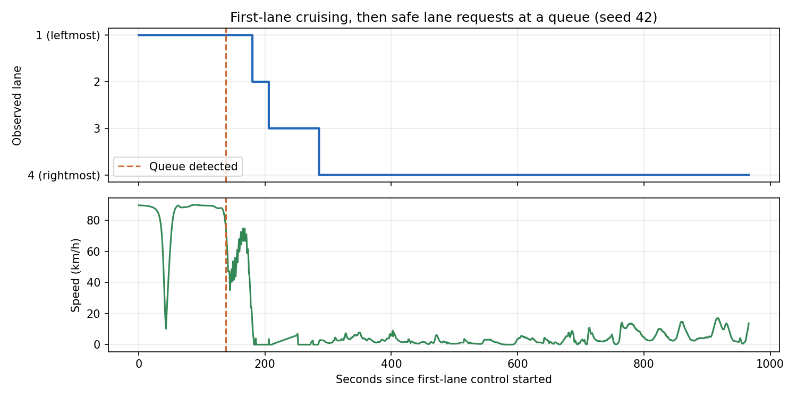

# SKKU 정체 수준·본선 주변 교통·정체 시 차로 변경

2026-09-28. 역 주변 정지 시간을 약 200초 수준으로 조정하고, 한산한 본선의 차량을 늘리며, ego가 1차로로 주행하다가 정체를 만나면 차로를 변경하도록 보완한다.

## 요청 범위

‘출구’에 대해서는 사용자 확인을 반영해 **진출로로 빠지는 경로 변경을 제외**했다. 서울→수원 기존 경로와 의왕톨게이트 통과를 유지한다. 1차로는 진행 방향 맨 왼쪽이며, 4차로 본선에서는 SUMO 내부 번호 3이다.

역 주변 정지 시간은 각 역 반경 600m 안에서 ego 속도가 0.1m/s 미만인 시간을 합산한다. 특정 교차로에서 인위적으로 200초 동안 차량을 멈추지 않고, 신호와 교통 흐름을 조정해 이 관측값을 목표로 삼는다. 교통 시드·도착 시각에 따라 달라지므로 모든 실행에서 정확히 200초를 보장하는 설정은 아니다.

## 본선 주변 교통 증가

[build_skku_freeway_traffic.py](build/build_skku_freeway_traffic.py)가 다차로 자동차전용도로와 제한속도 약 70km/h 이상 도로의 연속 구간을 찾는다. 도심 전체 수요를 일괄 증폭하지 않고 해당 구간에 약 4km 길이의 경로를 약 2km 간격으로 만든다.

- 같은 방향 6개, 반대 방향 6개 추가 경로, 각각 450대/시간의 합성 출발 수요.
- 기존 본선 수요에 총 5,400대/시간을 추가. 현재 전체 경로 출발 수요 합계는 약 15,285.56대/시간이다. 이는 전체 네트워크 합계이며 단일 도로의 통과 교통량이 아니다.
- 추가 차량은 출발 차로를 무작위로 선택해 여러 차로에 분산한다. 주행 중에는 SUMO의 연결·차로 변경 안전 제어를 따른다.
- 요금소를 지나는 추가 경로도 기존 여섯 요금소 차로 배분·6초 처리 규칙을 적용한다.
- 실행기는 ego 반경 250m 내 주변 차량 수를 궤적 CSV의 `nearby_vehicles_250m`에 기록한다. 제한속도 70km/h 이상 외부 도로의 관측 평균·최대는 주행 요약의 `open_road_neighbors_250m`에 남긴다. 이 값에는 반대편 차량도 포함된다.

## 1차로 주행 후 정체 시 차로 변경

[skku_queue_lane_change.py](control/skku_queue_lane_change.py)와 [queue_lane_change.json](../env/skku_commute/queue_lane_change.json)에 동작을 분리했다.

1. 톨게이트 전 약 4.5km 이내의 4차로 이상 본선에 들어오면 ego에 맨 왼쪽 차로 주행을 요청한다.
2. 톨게이트 전방 1.4km 이내에서 접근 도로·요금소 구간의 정지 차량이 합계 3대 이상이면 정체 대응을 시작한다.
3. 현재 차로에서 바로 오른쪽 차로로 이동을 요청한다. 3초 간격으로 상태를 확인하며, 기존 바깥쪽 요금소 목표에 맞춰 순차 이동한다.
4. 요금소에 들어오면 별도 차로 요청을 종료하고 기존 정차·통과·합류 동작을 따른다.

TraCI의 `changeLane`은 차로 이동 **요청**이다. 기본 안전 검사를 유지하므로 공간이 부족하면 기다리며, `moveTo`나 teleport, 충돌 검사 해제는 사용하지 않는다. 3초 연속 차로 변경 설정도 유지한다. 강화학습 정책이나 실시간 최단 대기열 선택 알고리즘이 아니라 요청한 관찰 시나리오를 위한 규칙 기반 제어다.

실제 맨 왼쪽 차로 주행, 정체 감지, 이후 차로별 관측과 요금소 통과는 `summary.json`의 `queue_lane_change.events`에 기록한다. 제어는 `run_skku_commute.py` 실행 시 적용된다. `.sumocfg`만 SUMO GUI에서 직접 열면 배경 교통·신호는 읽지만 이 TraCI 차로 요청 제어는 실행되지 않는다.

## 실행

```bash
python3 run_skku_commute.py --gui --background --viewport-m 800 --keep-open
```

차로 이동을 자세히 보려면 `--viewport-m 400`을 사용한다. 이미 실행 중인 GUI는 닫고 새로 실행해야 변경된 수요와 신호를 읽는다.

## 조정·검증 기록

이전 12번 문서의 68초·10초 정지는 이번 목표보다 짧아 다시 조정했다. 고속도로 수요를 늘린 상태에서 신호 후보를 비교하며, 중간 검사와 최종 결과를 구분해 기록한다. `exit_dense_seed42`는 진출로 해석을 확인하기 전에 시작했다가 중단한 시도이며 현재 경로가 아니다.

[첫 통합 검사](../results/skku_commute/queue_dense_seed42/summary.json)에서는 ego 완주, 맨 왼쪽 차로 주행, 정체 감지 후 SUMO 차로 3→2→1→0 이동 및 톨게이트 통과를 확인했다. 해당 검사의 역 주변 정지는 구반포역 82.5초, 성균관대역 185.5초여서 구반포역 신호를 추가 조정했다. 현재 코드에서는 연속 차로 변경 요청 간격도 3초로 맞췄으므로 첫 검사와 최종 설정은 구분한다.


## 최종 신호 배분

모든 주기는 90초, 황색·전체 적색과 신호 상태는 유지한다. 0.5초 시뮬레이션 간격에 맞는 단계 시간을 사용한다.

| 위치 | 직진 녹색 | 프로그램 시작 오프셋 |
|---|---:|---:|
| 구반포역 서쪽 신반포로 | 54초 | 10초 |
| 구반포역 서쪽 동작대로 접속부 | 39초 | 10초 |
| 구반포역 남쪽 동작대로 | 54초 | 10초 |
| 성균관대역 북쪽 서부로 | 55초 | 기존 값 유지 |
| 성균관대역 앞 연속 두 직진 | 각 17초 | 기존 값 유지 |

주행 도중 200초를 기다리게 하는 정차 명령을 넣지 않았다. [신호 생성기](build/build_skku_station_signals.py)와 [신호 기록](../env/skku_commute/station_signals.manifest.json)에 배분값·시작 오프셋을 기록한다. 신호 시작 시각은 모든 차량에 적용되며, 교차 방향의 대기나 다른 난수 시드까지 최적화한 것은 아니다.

[검사 도구](validation/audit_skku_queue.py)는 역별 정지 시간, 실제 차로 3→2→1→0 관측, 요금소 통과, 주변 차량 수와 XY 이동 연속성을 저장한다. 빠르게 주행하는 본선의 주변 차량 통계는 제한속도 70km/h 이상 도로에서 ego 속도 15m/s 이상인 표본만 따로 집계해 정체 구간과 구분한다.

## 최종 통합 검사: seed 42

[주행 요약](../results/skku_commute/queue_selected_seed42/summary.json) · [동작·정지 시간 검사](../results/skku_commute/queue_selected_seed42/queue_audit.json) · [검사 당시 코드·수요·신호](../results/skku_commute/queue_selected_seed42/source/)

| 항목 | 관측 결과 |
|---|---:|
| 구반포역 반경 600m 내 ego 정지 | **235초** |
| 성균관대역 반경 600m 내 ego 정지 | **198.5초** |
| 빠르게 주행 중인 본선에서 반경 250m 내 주변 차량 | 평균 **36.8대**, 1,110개 표본 |
| ego 전체 주행 시간 | 5,546초 |
| ego 충돌 / 전체 teleport | 0 / 0 |
| 배경 차량 충돌 보고 | 16건 |

두 역은 검사상 목표 범위 150~250초 안에 들어왔다. 이는 기본 seed 42·기본 수요의 관측 결과이며, 모든 seed에서 같은 시간을 강제로 맞추는 제어가 아니다.

- 시뮬레이션 3,392.5초부터 본선 1차로(SUMO 3)를 관측했다.
- 3,530.5초, 요금소 약 1.39km 전방에서 정지 차량 135대를 감지해 차로 변경 요청을 시작했다.
- 실제 이동은 안전 간격이 허용될 때 이루어졌다. 3,572.5초에 2차로, 3,598.5초에 3차로, 3,678초에 4차로를 관측했다. SUMO 내부 번호는 **3→2→1→0**이다.
- 4,374초에 의왕톨게이트 구간에 진입했고, 기존 경로로 수원 성대까지 완주했다. 별도 진출로로 우회하지 않았다.
- 0.5초 간격 XY 궤적에서 이동거리가 두 표본의 최대 속도×시간 간격+2m를 넘는 불연속은 없었다. 이는 ego 궤적 검사이며 모든 차량의 동역학 보증은 아니다.



**배경 차량 충돌 16건은 남아 있다.** 교통량 증가와 별개로 기존 교차로·톨게이트 진입부 연결 및 연속 차로 변경의 추가 보완이 필요하다. ego 완주와 요청 동작은 확인했지만 전체 교통 무충돌 검증으로 해석하지 않는다. [실험 목록](../results/skku_commute/experiment_index.json)에도 두 결과를 구분했다.

자동 검사 9개가 통과했다. 추가 경로 연결·도로별 수요 상한·톨게이트 여섯 차로 배분, 신호 상태·안전 시간·90초 주기, 정체 감지 전후 차로 요청을 확인했다. 최종 실행에 사용한 입력 파일과 현재 파일의 해시가 일치하고, 차로 제어 코드와 실행기 해시도 일치하는 것을 확인했다.
