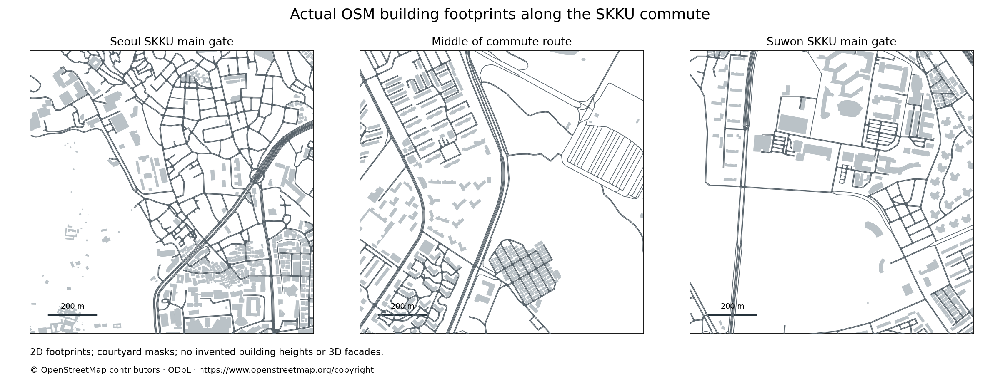
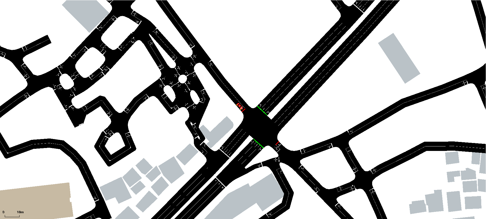

# 성균관대학교 서울 → 수원 환경: 건물·신호등 보완

> 2026-09-24: 한강·지명 표시와 정체 설정이 추가되었습니다. 한강·정체 설정은 [후속 문서](8_SKKU_한강_지명_정체.md), 차로 구성은 [차로·교량명 보완 문서](9_SKKU_본선_차로_교량명_보완.md), 현재 실행·검증 결과는 [톨게이트 차로 이용·합류 문서](10_SKKU_톨게이트_차로이용_합류.md)를 참고하세요. 아래 주행 시간은 교통량 변경 전 기록입니다.

작성일: 2026-09-23. SUMO 1.27.1. 도로와 기본 주행 구성은 [도로환경 문서](6_SKKU_서울_수원_도로환경.md)를 따른다.

약 38km 경로 주변에 **실제 OSM 건물 외곽선**을 표시하고, OSM에 명시된 신호 횡단보도와 **서울·과천·의왕·수원의 공식 신호시설 좌표**를 사용해 신호 위치를 보완했다. 건물은 2차원 배경이며, 신호 시간표는 실험용으로 생성했다. 이번 작업에는 새로운 강화학습 학습이나 평가가 포함되지 않는다.

경로상의 신호 제어기는 **10개에서 69개**로 늘었다. 같은 교차로의 여러 신호등은 하나의 제어기로 묶이므로 현장 신호등 기둥·등기구 수와는 다르다.

## 1. 건물 표시

기존 도로 수집 범위인 약 3km 단위 구간·주변 650m 여유 영역에서 건물 way와 multipolygon 관계를 별도로 내려받았다. 도로 원본은 변경하지 않았다. 원본 객체의 좌표와 외곽·안쪽 고리 관계를 보존하고, 중복 참조를 정리한 뒤 도로 네트워크와 같은 좌표계로 투영했다.

| 표시 결과 | 개수 |
|---|---:|
| 고유 OSM 건물 객체 | 18,626 |
| 건물 바깥 외곽 폴리곤 | 18,715 |
| 안뜰 표시용 마스크 | 66 |
| 화면에 추가한 전체 폴리곤 | **18,781** |
| 이름 / 높이 / 층수 태그가 있는 객체 | 3,032 / 1,896 / 2,598 |

고유 OSM 객체 수는 실제 건축물 동수와 반드시 같지 않다. 하나의 관계에 여러 외곽선이 있을 수 있어 객체 수와 폴리곤 수도 다르다. OSM에 없는 높이·층수·이름은 만들어 넣지 않았다.

건물은 도로보다 아래인 레이어 `-4`, 안뜰은 `-3.9`에 표시한다. 안뜰은 흰색 덮개 방식이므로 화면 배경색이나 겹치는 다른 배경 폴리곤의 영향을 받는다. 3차원 건물, 충돌 벽, 센서 가림 모델을 추가한 것은 아니다.



관련 파일: [수집기](download/download_skku_buildings.py), [건물 변환기](build/build_skku_buildings.py), [원본 기록](../env/skku_commute/buildings_source/manifest.json), [변환·검사 기록](../env/skku_commute/buildings.manifest.json), [SUMO 폴리곤](../env/skku_commute/buildings.poly.xml).

## 2. 신호 위치 자료와 날짜

시설 좌표를 저장한 날짜, 파일 게시 날짜, 현장 조사 날짜는 서로 다르다. 아래 자료를 합쳤다고 현재 운영 중인 모든 신호가 확인되는 것은 아니다.

| 자료 | 날짜와 범위 | 확보·선별 결과 |
|---|---|---|
| [서울시 신호등 관련 정보 OA-15546](https://data.seoul.go.kr/dataList/OA-15546/F/1/datasetView.do) | CSV 게시 2023-06-23, 좌표계 확인용 ZIP 게시 2021-08-09 | 원본 부착대 44,020행 중 경로 150m 이내 650행 |
| [서울 T-Data 교차로 MAP 정보](https://t-data.seoul.go.kr/dataprovide/trafficdataviewfile.do?data_id=10144) | 파일명 기준 2024-11-14 | 교차로 중심 1,000개 중 경로 주변 23개를 위치 교차검사에 사용 |
| [과천시 공간정보 교통시설물](https://www.data.go.kr/data/15129910/fileData.do) | 2026-02-04 게시, 개별 객체 날짜는 별도 | 신호등 388행, 제어기 60행 |
| [의왕시 신호등 설치 현황](https://www.data.go.kr/data/15108891/fileData.do) | 2022-12-02 기준 일회성 자료 | 2,533행; 원본이 미수집 자료 존재를 명시 |
| [전국신호등표준데이터의 수원시 자료](https://www.data.go.kr/data/15028198/standard.do) | 수원 행 기준일 2026-05-28 | 확보한 수원 자료 1,388행 |

경기도 결합 자료는 4,369행이다. 전국 표준자료는 웹 다운로드 상한인 50,000행을 확보해 필요한 도시를 추출했으며, 전국 전체 자료를 내려받았다는 의미가 아니다. 별도의 안양시 시설 자료는 확보하지 못했다.

서울 부착대는 신호등 여러 개를 지지할 수 있으므로 한 행이 전구 하나나 교차로 하나를 뜻하지 않는다. 650행은 차량 유형 326, 보행자 276, 경고등 46, 미분류 2행이다. 실제 차량 신호 후보는 일반 3·4색 유형과 전면 등 수량을 함께 확인한 **289행**으로 제한했다. 상태 코드의 ‘양호’도 현재 작동 중이라는 증거로 해석하지 않았다.

서울 좌표계는 공식 ZIP의 PRJ와 SHP/DBF를 비교해 EPSG:5186에 해당함을 확인했다. CSV의 Oracle SRID `2093`을 EPSG 번호로 사용하지 않았다. 이후의 CSV 좌표 변경은 임의로 과거 ZIP 위치에 맞추지 않고 유지했다.

과천 원본은 EPSG:5186을 명시한다. 의왕 CSV의 `위도`, `경도` 값은 실제로 투영 X/Y이며, 원본 설명의 ‘TM 중부 GRS80’과 의왕 지역의 좌표 범위를 근거로 EPSG:5186을 **추론**했다. 이 구분과 원시 좌표를 정규화 결과에 남겼다. 과천·의왕의 차량/보행 구분은 [광주시 공식 UIS 공통 코드 정의](https://gis.gjcity.go.kr/arcgis/rest/services/GJUIS/SGMapDynamic/MapServer/42)에 확인된 `SGB001/002`만 사용했다.

서울 자료는 공공누리 제1유형 출처표시 조건이다. 과천·의왕 원본 페이지는 이용허락범위 제한 없음으로 표시한다. OSM은 © OpenStreetMap contributors, [ODbL 1.0](https://www.openstreetmap.org/copyright)을 따른다. 원본 파일·다운로드 URL·요청 정보·SHA-256은 각 자료 폴더의 기록에 보존했다.

관련 파일: [서울 정규화기](prepare/prepare_seoul_signals.py), [서울 좌표·유형 검사](../env/skku_commute/signals_source/seoul/audit.json), [경기도 정규화기](prepare/prepare_gyeonggi_signals.py), [경기도 자료 설명](../env/skku_commute/signals_source/GYEONGGI_SOURCES.md).

## 3. 신호 위치를 도로에 연결한 방법

[신호 보완기](build/build_skku_signals.py)는 교차로라는 이유만으로 신호를 추가하지 않는다. 공식 좌표와 OSM의 명시적 신호 태그를 근거로 후보를 만든다.

1. `highway=traffic_signals` 외에 `crossing=traffic_signals`, `crossing:signals=yes`로 표시된 노드를 파생 OSM에 반영한다. 원본은 보존한다. 두 갈래 도로의 신호를 지우던 `--tls.discard-simple`도 사용하지 않는다.
2. 차량 신호 또는 제어기로 확인된 시설 중 경로 45m 이내의 후보를 찾는다. 보행등·경고등·미분류·전면 등 수량이 없는 서울 시설은 차량 제어 근거에서 제외한다.
3. 같은 교차로 주변 여러 부착대를 경로 진행 거리로 묶는다. 이웃 간격 65m, 한 묶음 전체 폭 100m를 상한으로 둔다.
4. 묶음의 각 원본 좌표와 배치할 SUMO 도로 노드 사이가 모두 80m 이내인지 확인한다. 가까운 기존 신호와 분기점을 우선하되, 연결 근거가 부족하면 미연결 상태로 남긴다.
5. 자동차전용도로·램프·교량·터널·층 정보와 주변 도로의 거리를 확인한다. 가까이 보이는 측도 신호를 본선 신호로 옮기는 잘못된 연결을 차단한다.

80m는 실제 설치 오차를 보증하는 수치가 아니라 자동 연결의 허용 상한이다. **원본 부착대·제어기 좌표와 파생 SUMO 제어 위치는 다른 값**이며, 둘 다 감사 기록에서 확인할 수 있다. 제어기 캐비닛 위치는 정지선이나 교차로 중앙으로 해석하지 않는다.

별도 [배치 검토 기록](../env/skku_commute/signals_source/placement_review.json)에는 다음 결정을 남겼다.

- 의왕의 램프 신호와 수원북부순환로 신호를 경수대로 본선에 붙이려던 연결을 제외했다.
- 반포대교·잠수교는 평면 좌표가 겹치지만 도로 층이 다르므로 소속이 불명확한 서울 시설 7행을 보류했다. 의왕 교량 램프 소속이 불분명한 1행도 보류했다.
- 신반포로는 같은 방향 지상도로가 가장 가까운 차량 신호 부착대 3행을 검토하고 도로상 제어 지점을 만들었다. 반대 차도 쪽 부착대는 이 위치 계산에서 제외했다.
- 일월로는 공식 도로명과 가장 가까운 경로 도로가 일치하는 자료 1행을 검토해 중간 횡단 구간 제어 지점을 만들었다.

두 중간 구간 위치는 원본 시설을 도로 중심선에 투영한 파생 위치다. 현장 측량한 정확한 정지선이 아니다. 배치 검토에는 도로 원본과 정규화 자료의 해시를 고정해, 입력이 바뀌면 오래된 검토를 그대로 적용하지 못하게 했다.

최종 연결·거절·미연결 목록은 [signals.manifest.json](../env/skku_commute/signals.manifest.json)과 [배치 계획](../env/skku_commute/signals.mapping_plan.json), OSM 태그 반영 내역은 [promotion 기록](../env/skku_commute/signals_source/roads_with_signal_crossings.osm.promotion.json)에 있다.

## 4. 신호 프로그램의 의미

신호 위치에는 실제 자료를 사용했지만 신호 프로그램은 **SUMO가 생성한 고정식 실험 설정**이다.

| 생성 옵션 | 설정 |
|---|---:|
| `tls.default-type` | `static` |
| `tls.cycle.time` | 명목 90초 |
| `tls.red.time` | 25초 |
| `tls.allred.time` | 2초 |
| `tls.yellow.time` | 3초 |

이는 생성기에 전달하는 값이며 모든 신호에서 각 색이 같은 시간 유지되거나 최종 주기가 정확히 90초임을 뜻하지 않는다. 교차로 연결과 현시 수에 따라 결과가 달라진다. 실제 제어 상태와 기간은 최종 `.net.xml`의 `tlLogic`에 저장된다.

수원 원본에는 녹색·황색·적색 순서와 시간 문자열도 있다. 그러나 접근 방향별 차로 대응, 모든 현시의 연결 관계, 공통 주기 기준시점이 확인되지 않아 현장 신호 프로그램으로 복원하지 않았다. 현재 환경을 실제 신호 연동이나 출퇴근 소요시간의 재현 결과로 해석하면 안 된다.

## 5. 재현과 실행

저장소 루트 `/home/mk/bmil_ws`에서 실행한다. 현재의 보관 원본·정규화 결과·배치 검토를 사용하는 재현 순서는 다음과 같다.

```bash
# 캐시가 유효하면 도로·건물 원본을 다시 요청하지 않는다.
.venv-skku/bin/python -m Road_Environment.download.download_skku_corridor
.venv-skku/bin/python -m Road_Environment.download.download_skku_buildings

# 신호·도로를 재생성하고 건물 투영, 수요, GUI 설정까지 갱신한다.
.venv-skku/bin/python -m Road_Environment.build.build_skku_commute

# 단독 완주 검사 / 주변 교통 포함 검사
python3 run_skku_commute.py --seed 42
python3 run_skku_commute.py --background --seed 42

# 주변 교통과 건물을 표시하며 빨간 ego를 추적한다.
python3 run_skku_commute.py --gui --background --viewport-m 800 --keep-open
```

`--output-dir`로 주행 결과 폴더를 지정할 수 있다. 각 결과에는 요약, 궤적, tripinfo, SUMO 로그와 입력 해시가 남는다. 운전 주체는 SUMO의 기본 모델이며 자동 차선변경과 안전 제어를 사용한다.

건물만 다시 투영하려면 `.venv-skku/bin/python -m Road_Environment.build.build_skku_buildings --overview`를 사용한다. 신호 원본의 정규화는 `prepare_seoul_signals.py`, `prepare_gyeonggi_signals.py`가 보관 자료에서 수행한다. **현재 환경 재현에는 정규화 재실행이 필요하지 않다.** 원본·경로·정규화 결과를 갱신했다면 입력 해시와 배치 검토부터 다시 확인한 뒤 전체 빌드·완주 검사를 수행해야 한다.

## 6. 건물·신호 보완 당시 검증 기록 (교통량 변경 전)

2026-09-23 15:04 KST에 생성한 최종 네트워크로 검사했다. 이전 도로 전용 환경은 [별도 사본](../results/skku_commute/road_only_snapshot/)에 보존했다. 최종 네트워크 SHA-256은 `6ac70300dfe4676accf2dd1146f3bdb6847e20cf6a4c1e7bd02651006da62b6d`이다.

| 검사 | 최종 결과 | 근거 |
|---|---|---|
| 전체 네트워크 / 경로상 신호 제어기 | 235 / **69개** | [환경 기록](../env/skku_commute/manifest.json) |
| 공식 자료 자동 연결 | 220행 → 62묶음, 노드 46개에 추가 요청(45개 직접 제어, 1개 공동 제어 내부) | [신호 기록](../env/skku_commute/signals.manifest.json) |
| 건물 재투영·닫힌 고리·유한 좌표·고유 ID | **18,781개, 통과** | [건물 검사](../env/skku_commute/buildings.manifest.json) |
| 신반포로·일월로 중간 신호 | 2곳 모두 실제 진행 경로 제어에 연결 | [프로그램 검사](../results/skku_commute/signal_program_audit.json) |
| 경로 신호 프로그램 | 69개 제어기, 151개 차로 연결 모두 녹색·적색 존재, 주기 90초 | 같은 검사 기록 |
| 잘못 연결될 우려가 있는 검토 자료 | 10행 제외, 램프→본선 오매칭 2곳 제거 확인 | [배치 검토](../env/skku_commute/signals_source/placement_review.json) |
| GUI 정지·건물 표시 | 적색 신호 1.70m 앞 속도 0m/s, 건물 18,781개 로딩 | [화면 검사](../results/skku_commute/buildings_signals_final_gui_seed42/visual_closeup_check.json) |

OSM의 신호 횡단보도·복합 신호 태그 188개를 변환 입력에 반영했으며, 이 수는 전체 수집 영역의 원본 태그 보완 건수다. 경로 제어기 증가분에는 이 보완, 단순 구간 신호 유지, 검토한 중간 신호 2곳, 공식 시설의 자동 연결이 함께 포함된다.

자동 연결에 남은 이수교차로 주변 1묶음·6행은 따로 점검했다. 서로 85.8m 떨어진 기존 신호 두 곳을 한 묶음으로 합친 경우였다. 2행은 기존 제어기 `4683581778`, 4행은 `cluster_2551950297_921145139`에 이미 대응한다. 서울 T-Data의 이수교차로·이수교차로(연등) 중심 좌표와도 대조했으므로 신호를 중복 추가하지 않았다. 자동 연결 220행과 이 검토 6행은 [별도 배치 검사](../results/skku_commute/signal_placement_audit.json)에서 구분한다.

| 최종 주행 조건 | 완주 시간 | 거리 | 대기시간 | 전체 차량 충돌 / teleport |
|---|---:|---:|---:|---:|
| [배경 교통 seed 42](../results/skku_commute/buildings_signals_final_seed42/summary.json) | 58분 16.5초 | 38.34725km | 780.5초 | **0 / 0** |
| [배경 교통 seed 43](../results/skku_commute/buildings_signals_final_seed43/summary.json) | 58분 16.5초 | 38.34725km | 792.0초 | **0 / 0** |
| [GUI, 배경 교통 seed 42](../results/skku_commute/buildings_signals_final_gui_seed42/summary.json) | 58분 16.5초 | 38.34725km | 780.5초 | **0 / 0** |

두 seed의 최종 도착 시간은 같지만 출발 차량 수는 2,063 / 2,073대, ego 차선변경은 31 / 24회로 교통 상황은 다르다. 이는 정해진 신호 프로그램을 사용하는 실험 결과이며 실제 이동시간 예측이 아니다. 단독 주행의 기존 결과는 이전 지도에 대한 검사이므로 이 표에 섞지 않았다.

SUMO 로그에는 배경 차량의 급제동 경고와 직접 제어 연결이 없는 병합 교차로 제어기의 미사용 상태 경고가 남는다. 후자는 공동 제어 구역의 내부 노드이며 상류 신호의 제어를 따른다. 충돌 0건을 승차감이나 대규모 안전성 검증으로 해석하면 안 된다. 경로의 모든 직접 제어 연결에는 적색과 진행 가능한 녹색이 있음을 별도로 확인했다.



[실험 목록](../results/skku_commute/experiment_index.json)의 `previous_revision`에 당시 사용 파일과 검사 결과의 해시를 보존했다. 세 주행 검사는 건물·신호 보완 당시 설정을 대상으로 했으며, 이후 교통량을 변경한 현재 설정의 결과는 후속 문서를 따른다. [신호 프로그램 검사 스크립트](../results/skku_commute/audit_signal_programs.py)도 보존했다.

건물 변환기는 닫힌 고리, 유한 좌표, 양의 면적, 고유 ID와 원본 속성 보존을 검사한다. 신호 검사는 자료 연결의 근거를 추적하는 과정이며 실제 도로의 완전한 측량 검증을 대신하지 않는다.

## 7. 남은 한계

OSM에 누락된 건물·차로·신호, 서로 다른 자료의 조사 시차, 신호가 제어하는 차도·방향의 불명확성이 남아 있다. 미분류·미연결 시설을 모두 반영했다고 주장하지 않으며, **현재 시점의 모든 신호등·정확한 정지선·실제 현시를 완전히 복원한 환경은 아니다.**

건물 폴리곤은 시각적 배경이므로 차량 운동, 충돌 판정, 관측·보상에 자동 반영되지 않는다. 배경 교통도 관측 교통량으로 보정된 수요가 아니다. 이번 보완 결과는 이후 장거리 주행 환경과 학습 과제를 구성하는 바탕이며, 이 도로에서 학습된 PPO 정책이나 안전 제어 없는 자율주행 성능을 뜻하지 않는다.
