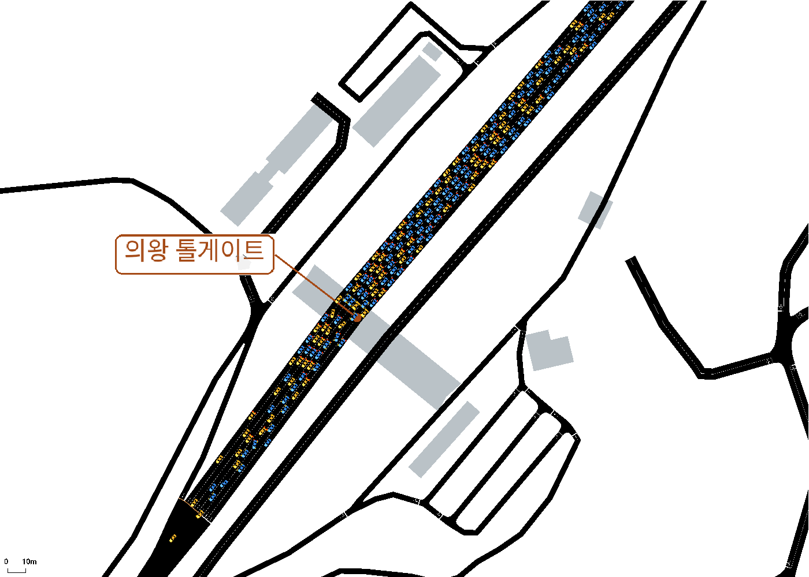
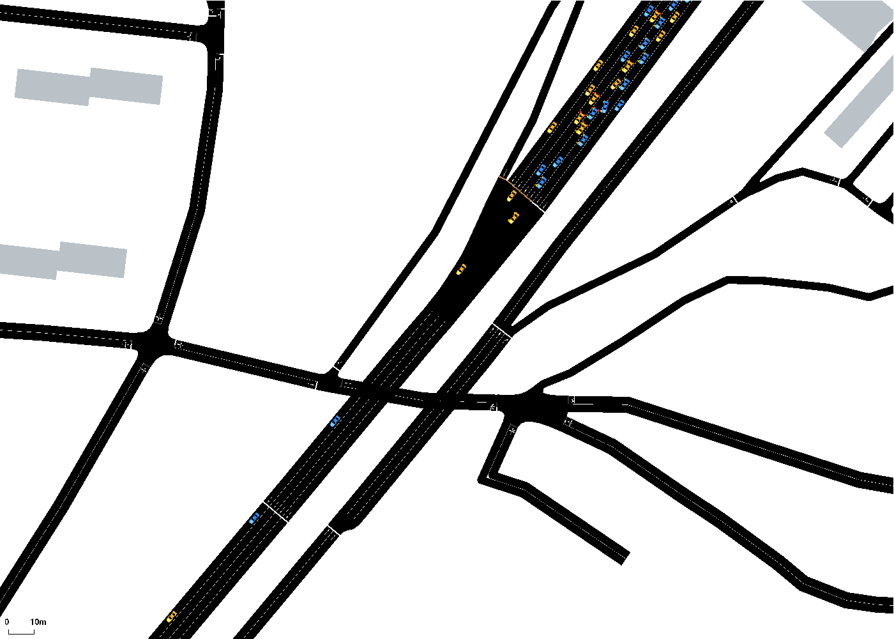

# SKKU 서울 → 수원: 전체 수정 내역과 현재 실행 설정

> 후속 신호 조정: [12번 문서](12_SKKU_역주변_직진신호_연장.md)에 성균관대역·구반포역 직진 시간 연장을 기록했다. 아래 주행 수치는 신호 연장 전 결과다.

2026-09-24. [4→6→4차로 보정](9_SKKU_본선_차로_교량명_보완.md) 후, 추가 차로가 실제로 이용되지 않는 문제를 수정했다. 기존 검사는 연결 유무만 확인했으므로 **차로별 실제 이용·요금소 처리·이후 합류 완료**까지 검사를 확장했다.

> 2026-09-28 후속 변경: [11번 문서](11_SKKU_양방향_교차로_교통.md)에서 반대 방향과 교차로 주변 교통을 추가했다. 아래 완주·충돌 수치는 해당 추가 전 결과다.

이 문서는 톨게이트 보완 시점의 통합 정리다. 6~9번 문서는 단계별 구축 기록으로 보존하며, 과거 문서의 주행 시간·교통량·표시 개수는 현재 값과 구분한다.

## 전체 수정 내역

| 항목 | 현재 반영 내용 | 근거·상세 기록 |
|---|---|---|
| 실행 경로 오류 | 시스템 SUMO가 설치된 현재 PC에서는 `python3`로 실행. 실행기가 `/usr/share/sumo/tools` 또는 `SUMO_HOME/tools`에서 SUMO 모듈을 찾음 | [실행기](../run_skku_commute.py) |
| 건물·신호 | OSM 건물·안뜰 폴리곤 18,781개, 경로상 신호 제어기 69개 유지 | [7번 문서](7_SKKU_건물_신호등_보완.md) |
| 한강 색상 | 실제 OSM 수면 외곽선과 섬을 반영. 수면은 청색 `#68AEDE`, 도로 아래 레이어에 표시 | [8번 문서](8_SKKU_한강_지명_정체.md) |
| 서울 시내 정체 | 기본 구간 수요 100대/시간 대비 북쪽 2배, 남쪽 1.3배. 서울 합류 수요는 60→100대/시간 | [수요 생성기](../build_skku_commute.py) |
| 출발 전 교통 형성 | 주변 교통을 300초 먼저 흘린 후 ego 출발 | [주행 수요](../env/skku_commute/skku_commute.rou.xml) |
| 의왕톨게이트 접근 정체 | 전용 배경 수요 1,200대/시간, 접근 구간 속도 2m/s와 차로별 6초 처리시간 적용 | [정체 설정](../env/skku_commute/congestion.manifest.json) |
| 본선 차로 | 봉담과천로 수원 방향 본선 25개 구간은 4차로, 요금소 구간은 6차로. 4→6→4 연결 | [차로 보정 기록](../env/skku_commute/lanes.manifest.json) |
| 지명 표시 | 역 37곳, 톨게이트 4곳, 큰 교량 3곳, 한강 1곳으로 총 45개 이름표 | [지명 기록](../env/skku_commute/landmarks.manifest.json) |
| 교량 이름 정리 | 반포대교·잠수교·동작대교만 표시. 진입·진출부 소교량·고가교 이름과 중복 이름 제외 | [9번 문서](9_SKKU_본선_차로_교량명_보완.md) |
| 한글 이름표 | Noto Sans CJK로 만든 PNG 사용. 의왕톨게이트 이름표는 차량을 가리지 않도록 도로 옆에 배치 | [지도 생성기](../build_skku_landmarks.py) |
| 추가 차로의 실제 이용 | 요금소 통과 수요를 6개 차로에 분산하고, 앞쪽 4차로에서 진입하도록 구성 | 아래 차로별 시뮬레이션 관측 결과 |
| 차로 변경·합류 | 3초 연속 차로 변경과 요금소 출구 `zipper` 합류. 차량별 실제 이용·합류 완료와 XY 궤적 확인 | [관측 검사기](../audit_skku_toll.py) |

서울 구분은 구간 시작점 위도 37.54/37.46을 기준으로 한 실험 구역이며 행정경계 판정은 아니다. 지명은 기본적으로 경로 1.2km 이내의 보관 OSM 자료를 사용한다. 한강과 건물은 시각적 배경이며 차량 충돌 벽으로 추가한 것이 아니다.

최신 네트워크의 요금소 도로 구간 `507449308` 길이는 **540.88m**, 차로별 정차 위치는 시작점으로부터 약 **398.7m**다. 9번 문서의 약 595m는 `zipper` 합류 적용 전 값이며, 합류 교차로 내부 형상을 재계산하면서 도로 구간과 내부 연결의 길이 배분이 바뀌었다.

원본 OSM은 유지하고 파생 SUMO 네트워크를 수정했다. 차로 수 보정은 사용자 요청을 반영한 수원 방향 시나리오 설정이며, 반대 방향·지선의 차로 수나 현장 하이패스 운영을 새로 조사한 결과는 아니다. 현재 신호 프로그램은 그대로 유지했다. 새로 강화학습한 정책은 없으며 운전은 SUMO 기본 모델이 수행한다.

## 변경한 동작

- 톨게이트를 지나는 배경 수요를 여섯 요금소 차로에 1/6씩 배분한다. 전체 시간당 교통량은 유지하고 출발 시각을 엇갈리게 배치한다. 차량을 추가된 6차로 안에서 생성하지 않고, 앞쪽 4차로에서 들어오게 했다.
- 차량에는 사용할 요금소 차로의 정차 위치를 지정한다. SUMO의 기본 주행·차로 변경 모델이 그 차로로 이동하고, 합성 요금소 처리시간 **6초**를 보낸 뒤 출발한다. ego는 추가된 바깥 차로를 목표로 한다.
- 요금소 이용 **배경 차량 유형**에는 우측 통행 선호를 끄고 전략적 차로 선택의 선행 거리를 늘렸다(`lcKeepRight=0`, `lcStrategic=5`). 선택한 요금소 차로에서 불필요하게 오른쪽으로 이동했다가 돌아가는 동작을 줄이기 위한 설정이다. ego에는 이 두 매개변수 변경을 적용하지 않고 바깥 차로의 정차 목표만 지정했다.
- 차로 변경은 `lanechange.duration=3`으로 연속적으로 표시한다. 출구에는 SUMO의 `zipper` 합류를 적용하고 여섯 차로의 출구 연결을 유지한다. 차량 위치를 순간적으로 옮기거나 차로 변경 안전 검사를 해제하지 않는다.
- 요금소 이름표는 도로 옆으로 옮기고 위치 연결선을 추가해 차량을 가리지 않도록 했다.

이는 **실험용 요금소 선택·처리 모델**이다. 실제 하이패스/일반 차로 배치나 처리시간을 조사해 복원한 것이 아니다. 차로 선택 비중은 고정되어 있으며 실시간 최단 대기열 선택 모델은 아니다. SUMO 내부 차로 번호 0이 진행 방향의 가장 오른쪽이므로 이번에 추가된 바깥 두 차로는 0·1이다.

## 실제 이용 확인

각 숫자는 서로 다른 차량 수다. ‘합류 완료’는 앞쪽 4차로에서 진입한 차량이 해당 요금소 차로를 이용한 뒤, 뒤쪽 4차로에서 다시 관측된 경우만 센다.

| 요금소 차로(SUMO 번호) | seed 42 처리 시작 / 합류 완료 | GUI seed 43 처리 시작 / 합류 완료 |
|---|---:|---:|
| 추가 바깥 차로 0 | 314 / 284 | 330 / 298 |
| 추가 바깥 차로 1 | 310 / 280 | 321 / 290 |
| 차로 2 | 331 / 294 | 336 / 303 |
| 차로 3 | 331 / 298 | 358 / 325 |
| 차로 4 | 299 / 271 | 317 / 289 |
| 차로 5 | 352 / 322 | 375 / 342 |

검사는 ego 도착 시 종료하므로, 검사 종료 시점에 요금소에 남아 있는 차량은 합류 완료에 포함되지 않는다. 두 검사 모두 6개 차로가 동시에 이용되는 것을 관측했다.

- seed 42: 시뮬레이션 시각 5,959초에 완주. 충돌 0, 강제 이동 0.
- GUI seed 43: 시뮬레이션 시각 6,287.5초에 완주. 충돌 0, 강제 이동 0.
- 출발은 두 경우 모두 시뮬레이션 300초다. 서울 정체와 톨게이트 접근 정체를 유지했다.
- 각 검사에서 대표 차량 6대와 ego의 0.5초 간격 XY 궤적을 저장했다. 연속 표본의 이동거리가 두 표본의 최대 속도×시간 간격+2m를 넘는 불연속은 없었다. 이는 추적한 7대의 연속성 검사이며 전체 교통의 정밀 동역학 검증은 아니다. 급제동 경고는 남아 있다.

[seed 42 검사](../results/skku_commute/toll_service_final42/audit.json), [GUI seed 43 검사](../results/skku_commute/toll_service_gui43/audit.json), [차로 이동 사건](../results/skku_commute/toll_service_gui43/toll_lane_events.csv), [대표 차량 XY 궤적](../results/skku_commute/toll_service_gui43/toll_motion.csv), [궤적 연속성 검사](../results/skku_commute/toll_service_gui43/motion_checks.json).




## 실행·재현

이미 열려 있는 SUMO 창은 닫고 다시 실행해야 새 수요와 차로 선택 설정을 읽는다.

```bash
cd /home/mk/bmil_ws
python3 run_skku_commute.py --gui --background --viewport-m 400 --keep-open
```

빨간 ego를 따라가면 추가된 바깥 차로의 진입, 요금소 처리와 출발, 이후 본선 합류를 볼 수 있다. 전체 이름표를 보려면 화면 범위를 `800`으로 늘린다.

기본 GUI 지연에서는 300초의 사전 교통 형성에 실제 시간 약 12초가 걸린다. `--delay-ms 0`은 최대 속도로 재생하고, `--keep-open`은 주행 종료 후 창을 유지한다. `--background`를 빼면 주변 차량 없이 즉시 출발하지만 요금소 속도 제한과 ego의 6초 정차는 유지된다. 결과는 기본적으로 `results/skku_commute/`의 실행 시각별 폴더에 저장된다.

```bash
python3 download_skku_landmarks.py  # 보관 자료 재사용, 새 수집은 --refresh
python3 build_skku_commute.py --skip-convert
python3 validate_skku_landmarks.py --gui --seed 43 --output-dir results/skku_commute/my_toll_check
```

`--skip-convert` 재생성에서는 기존 도로를 재수집하지 않고 필요한 차로 보정, 수요, 한강·지명, GUI 설정을 갱신한다. 이름표를 다시 만들 때는 Pillow, fontconfig와 한국어 글꼴이 필요하다. 생성된 파일로 주행만 할 때는 이름표 이미지를 그대로 사용한다.

[관측 전용 차로 검사기](../audit_skku_toll.py)는 주행을 제어하지 않고 차로별 차량 ID와 이동 경로를 기록한다. 검증기는 모든 요금소 차로에서 최소 10대의 이용과 합류 완료를 요구한다. [설정 기록](../env/skku_commute/congestion.manifest.json)과 [실험 목록](../results/skku_commute/experiment_index.json)에 입력 해시를 남겼다.

## 관련 파일과 변경 이력

| 파일 | 역할 |
|---|---|
| [build_skku_commute.py](../build_skku_commute.py) | 통합 빌드, 지역별 교통 수요, 요금소 차로 배분·정차, 실행 설정 |
| [build_skku_lanes.py](../build_skku_lanes.py) | 본선 4차로·요금소 6차로, 진입·출구 연결, zipper 합류 |
| [build_skku_landmarks.py](../build_skku_landmarks.py) | 한강, 한글 지명, 큰 교량 선별, 이름표 배치 |
| [download_skku_landmarks.py](../download_skku_landmarks.py) | OSM 지명·한강·교량 자료 수집 및 캐시 재사용 |
| [run_skku_commute.py](../run_skku_commute.py) | 시스템 SUMO 모듈 경로 처리, GUI·일반 주행 및 결과 저장 |
| [validate_skku_landmarks.py](../validate_skku_landmarks.py) | 완주·안전 사건·정체·차로 이용과 합류 검증, GUI 화면 저장 |
| [audit_skku_toll.py](../audit_skku_toll.py) | 차로별 실제 차량 ID, 진입·합류 사건, 대표 차량 궤적 기록 |

수정 전 네트워크는 `env/skku_commute/lanes_source/`에 압축 보관했다. [실험 목록](../results/skku_commute/experiment_index.json)의 `previous_revision`에 앞선 실험을 보존했다. 8번의 58개 이름표와 약 104~109분 결과, 9번의 약 84~86분 결과는 각각 당시 설정의 기록이며 현재 검사 결과와 혼합하지 않는다.

구현 참고: SUMO [차량 정차 정의](https://sumo.dlr.de/docs/Definition_of_Vehicles%2C_Vehicle_Types%2C_and_Routes.html), [연속 차로 변경 옵션](https://sumo.dlr.de/docs/sumo.html).

## 2026-09-28: 서울→수원 전용 프로젝트로 정리

- 혜화로터리 구축·학습·재생 스크립트, `env/hyehwa/`, `results/hyehwa/`, 전용 테스트와 구축·학습 문서를 삭제했다.
- 서울→수원 코드가 사용하지 않는 이전 BC/PPO 학습 코드(`algorithms/`, `utils/`, `train*.py` 등), 수집 데이터(`data/`), 이전 학습 결과와 구형 도로 환경(`env/sumo/` 및 관련 Python 코드), 실습 문서 0~4번을 삭제했다.
- 서울→수원 구축·실행·검증 스크립트, 문서 6~10번, `env/skku_commute/`와 `results/skku_commute/` 전체를 유지했다. 도로·건물·신호·수요·차로 설정은 이번 정리에서 변경하지 않았다. 서울 출발 구간의 실제 지명인 혜화역 표시는 유지한다.
- [README](../README.md)를 서울→수원 실행 안내로 정리하고 [requirements-skku.txt](../requirements-skku.txt)를 분리했다. 현재 코드의 선택적 가상환경 경로는 `.venv-skku`로 통일했다. 현재 PC에서는 기존처럼 `python3 run_skku_commute.py --gui --background --viewport-m 400 --keep-open`으로 실행한다.
- 과거 SKKU 실험 폴더 안의 코드 스냅샷과 해시는 당시 재현 기록이므로 그대로 보존한다. 거기에 남은 과거 가상환경 경로는 현재 실행 안내가 아니다.

정리 후 확인: 건물 형상 테스트 3개 통과, 실행기 `--help` 정상, SUMO 환경 로딩 후 5초까지 진행(차량 28대) 확인. `env/skku_commute/`와 `results/skku_commute/`의 473개 파일은 삭제 전후 SHA-256이 모두 같고, README·문서 6~10번의 로컬 링크도 모두 유효하다. 이번 확인은 실행 의존성 점검이며 전체 경로 완주를 다시 검사한 것은 아니다.


## 2026-09-28 후속: 반대 방향·교차로 교통 확장

[11번 문서: 양방향·교차로 주변 교통](11_SKKU_양방향_교차로_교통.md)에 다음 변경을 정리했다.

- 반대 방향 14개, 교차로 주변 150개 배경 경로 추가.
- 교차로별 수요 분산과 공유 도로의 추가 교통량 상한 적용.
- 혼잡을 고려해 실행·수요 종료 시간을 3시간으로 확대.
- 차로 변경 안전 간격 보완과 충돌 제거를 도착으로 오인하던 판정 수정.
- 중간 검사 실패와 최종 검사 결과를 구분해 기록.

이 문서 앞부분의 5,959초·6,287.5초 완주 및 무충돌 수치는 양방향 교통 추가 전 결과다. 최신 실행 결과는 11번 문서를 따른다.
