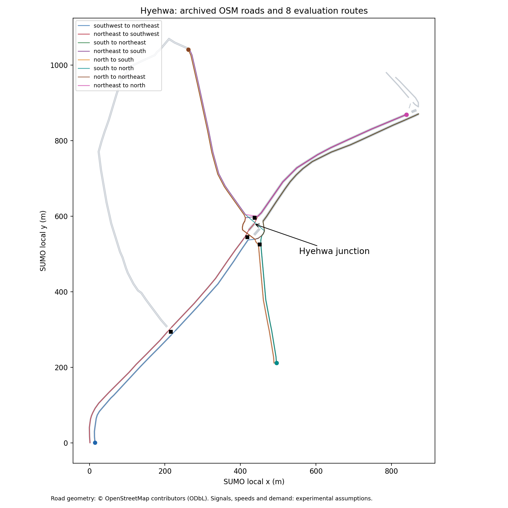
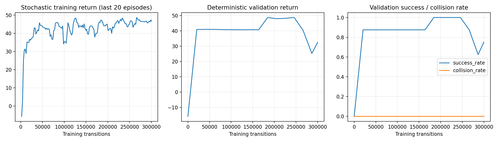
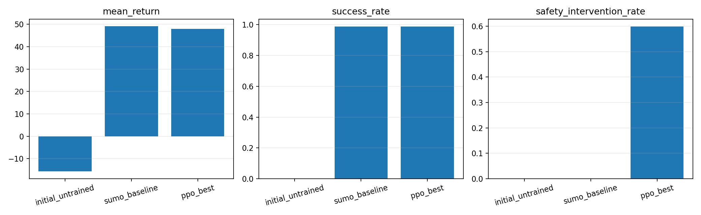

# 5. 혜화로터리(혜화 교차로): 실제 지도 기반 SUMO 환경 구축과 PPO 학습

작성 기준: 2026-09-23. **세 실험의 학습을 모두 완료했고, 최종 모델은 3차 실험의 245,760스텝 `best.pt`로 선택했다.** 검증에서 8/8 완주를 달성했으며, 별도 테스트로 실험을 고르지 않았다.

총 학습량은 **500,000 transition, 완료 에피소드 1,087개**다. 세 실행의 학습·검증 소요 시간 합계는 **947.43초(약 15분 47초)**이며, 환경 준비·별도 테스트·재생 제작 시간은 포함하지 않는다. 선택된 실험 자체는 300,000스텝 실행이고, 평가·재생에 사용하는 checkpoint는 그중 245,760스텝 모델이다. 여러 실험의 500,000스텝을 하나의 모델이 연속 학습한 것은 아니다.

바로 확인하기: [선택된 모델](../results/hyehwa/ppo_routecost_300k_seed42/best.pt) · [모델 설정](../results/hyehwa/ppo_routecost_300k_seed42/config.json) · [checkpoint 검증 결과](../results/hyehwa/ppo_routecost_300k_seed42/best.json) · [8개 경로 주행 궤적](../results/hyehwa/ppo_routecost_300k_seed42/replay/trajectories.png) · [차선 변경 구간 GIF](../results/hyehwa/ppo_routecost_300k_seed42/replay/mandatory_lane/replay_northeast_to_south.gif).

**OpenStreetMap에서 가져온 혜화 교차로 도로망 위에서, 차량의 가감속과 차선 변경을 PPO로 학습한다.** 실제 지도에서 도로의 형상과 연결 관계를 가져왔으며, 교통량·신호 주기·누락된 제한속도는 실험을 위해 설정했다. 따라서 실제 지역을 바탕으로 한 시뮬레이션이며, 현장 교통을 계측하여 그대로 복원한 환경은 아니다.

이 모델은 **BC 사전학습 없이 무작위 초기화에서 시작한 RL 모델**이다. IDM의 정답 행동 데이터로 지도학습하지 않는다. 목적지와 경로는 미리 지정하고, 정책이 그 경로를 주행하기 위한 가감속과 차선 변경을 학습한다. 조향각과 경로 탐색은 정책의 출력에 포함되지 않는다.

> 별도 교통 시드 80개에서 PPO는 **79/80 완주(98.75%), 충돌 0회**였다. SUMO 기준선도 79/80 완주했다. PPO의 안전 제어 개입률은 **59.88%**이므로 독립적인 안전 운전을 달성했다고 해석하지 않는다. [전체 평가 결과](../results/hyehwa/ppo_routecost_300k_seed42/evaluation_summary.json)를 저장했다.

## 1. 도로망의 출처와 구축 범위

원본은 [OpenStreetMap Map API](https://api.openstreetmap.org/api/0.6/map?bbox=126.994,37.580,127.010,37.594)에서 2026-09-23 03:39:21 UTC에 내려받은 OSM XML이다. 같은 URL의 향후 응답은 달라질 수 있으므로, 재현에는 저장된 원본 스냅샷을 사용한다.

- 원본 범위 `(서쪽 경도, 남쪽 위도, 동쪽 경도, 북쪽 위도)`: `(126.994, 37.580, 127.010, 37.594)`.
- 변환 대상 중심 범위: `(126.997, 37.5824, 127.006, 37.5891)`.
- 혜화 교차로 중심 표기 좌표: 경도 `127.0012`, 위도 `37.58565`.
- 도로 분류: 주요 도로인 primary·secondary·tertiary와 연결도로를 가져오고, 가장 큰 연결 성분을 사용한다.
- 최종 네트워크: **외부 도로 링크 26개, 노드 17개, 신호 제어기 2개**. 외부 링크 수에는 교차로 내부 연결 링크가 포함되지 않는다.
- 두 신호 제어기의 주기는 각각 **75초**다. 중앙 교차로의 여러 노드를 공동 제어하고, 같은 제어기 내부 링크에는 별도 신호 정지선을 반복해서 두지 않는다.

원본 데이터는 © OpenStreetMap contributors, ODbL 1.0 조건을 따른다. [저작자 표시와 이용 조건](https://www.openstreetmap.org/copyright)은 [ATTRIBUTION.md](../env/hyehwa/ATTRIBUTION.md)에도 보존했다. 취득 URL·시각·SHA-256은 [source.json](../env/hyehwa/source.json), 변환 명령과 결과 해시는 [manifest.json](../env/hyehwa/manifest.json)에 기록했다.



다음 항목은 실측값과 구분해야 한다.

| 항목 | 이번 실험의 처리 |
|---|---|
| 도로 형상·일방통행·차선 수 | OSM 태그를 변환하여 사용. 누락되거나 부정확한 태그가 있을 수 있음 |
| 차선 수의 정확성 | 일부 일방통행 way에 `lanes=6`이 있어 방향별 6차선으로 반영됨. 현장 차선 수를 검증한 값은 아님 |
| 제한속도 누락 | 주요 간선도로 50km/h, tertiary 도로 30km/h를 기본값으로 적용 |
| 신호 계획 | 연결 관계에서 생성한 75초 주기. 서울시 실제 신호 시간표가 아님 |
| 교통량 | 경로당 기대값 90대/시간, 8개 경로 합계 720대/시간인 확률적 유입 |
| 배경 차량 | 승용차 IDM 60%, Krauss 40% 혼합. 실제 차량 분포를 추정한 값은 아님 |
| 제외한 교통 요소 | 작은 골목, 보행자·자전거, 실제 버스 운행과 정류장 운영 |

구축 코드 [build_hyehwa.py](../build_hyehwa.py)는 원본 다운로드 → 도로 변환 → 신호 생성 → 경로 연결 검증 → 배경 수요 생성 → 설정·그림·manifest 저장 순서로 실행한다. 기본 실행은 보존된 OSM 원본을 재사용하고 해시를 확인한다. `--refresh`는 원본을 새로 내려받는 옵션이므로 동일 실험 재현에는 사용하지 않는다.

## 2. 주행 과제와 환경

[env/hyehwa_env.py](../env/hyehwa_env.py)의 `HyehwaEnv`가 Gymnasium 인터페이스를 제공한다. 각 에피소드에서 주행 경로 하나를 선택하고, SUMO 배경 교통이 있는 도로에 제어 차량을 투입한다.

| 경로 ID | 방향 | 외부 링크 길이 합 |
|---|---|---:|
| `north_to_northeast` | 북쪽 → 북동쪽 | 1,030.92m |
| `north_to_south` | 북쪽 → 남쪽 | 816.58m |
| `northeast_to_north` | 북동쪽 → 북쪽 | 957.14m |
| `northeast_to_south` | 북동쪽 → 남쪽 | 835.05m |
| `northeast_to_southwest` | 북동쪽 → 남서쪽 | 1,192.05m |
| `south_to_north` | 남쪽 → 북쪽 | 804.27m |
| `south_to_northeast` | 남쪽 → 북동쪽 | 850.48m |
| `southwest_to_northeast` | 남서쪽 → 북동쪽 | 1,208.38m |

길이는 manifest에 기록된 외부 도로 링크 길이 합으로, 개별 차량의 차선 이동·교차로 내부 이동까지 포함한 실제 주행거리와는 다를 수 있다. 경로는 [routes.json](../env/hyehwa/routes.json)에 저장되어 있으며 모두 혜화 중앙 교차로를 거치도록 검사한다.

실험 설정은 다음과 같다.

- 제어 간격: **0.5초**.
- 에피소드 한도: **1,200스텝 = 제어 시간 600초**. 초기 교통 준비·차량 투입 대기 시간은 별도다.
- 초기 교통 준비: 40스텝, 즉 20초.
- 주변 차량 관측 범위: 100m.
- 완료 조건: 도착, 충돌, 차량 제거·텔레포트. 시간 한도는 `truncated=True`로 기록한다.
- 정책 주행에서 SUMO의 자동 경로용 차선 변경 지원: **꺼짐**(`strategic_route_assist=false`).

### 관측 65차원과 행동 2개

관측은 `[-1, 1]` 범위로 정규화·클리핑한 65차원 벡터다.

| 구성 | 차원 | 내용 |
|---|---:|---|
| 차량·도로·경로·신호·직전 행동 | 23 | 속도와 가속도, 허용속도, 차선 번호·개수·남은 거리, 경로를 위한 권장 차선 방향과 연결 여부, 경로 진행률, 다음 도로 방향, 다음 신호 거리·색, 선행차 간격·상대속도, 내부 도로 여부, 진행 방향, 직전 행동 |
| 가까운 주변 차량 6대 | 42 | 차량당 존재 여부, 전후·좌우 상대 위치, 전후·좌우 상대속도, 상대 진행 방향의 sin·cos 값 7개 |

현재 모델은 단일 시점 관측과 직전 행동을 사용하는 MLP다. LSTM이나 과거 여러 프레임을 쌓는 기억 구조는 사용하지 않는다.

정책의 출력은 연속 가감속과 이산 차선 명령을 함께 사용하는 **하이브리드 행동**이다.

- 가감속: 정규분포에서 샘플링한 값을 환경에서 `[-1, 1]`로 제한한다. `+1`은 최대 `2.6m/s²` 가속 요청, `-1`은 최대 `4.5m/s²` 감속 요청이다.
- 차선 변경: 왼쪽 `+1`, 유지 `0`, 오른쪽 `-1` 중 하나를 선택한다.
- 평가·재생: 가감속 분포의 평균과 차선 확률이 가장 높은 선택을 사용한다.

환경의 Gym 행동 공간 표기는 길이 2의 `Box`지만, 정책 내부에서 차선 변경은 3개 범주의 `Categorical` 분포로 처리한다. 정책이 요청한 속도·차선 이동과 실제 SUMO에서 적용된 결과는 다를 수 있다.

### 보상과 안전 보조

주요 보상은 진행거리 1m당 `+0.03`, 도착 `+20`, 충돌 `-50`, 차량 제거·텔레포트 `-20`, 시간 초과 `-10`이다. 일반 주행에는 0.5초 스텝당 `-0.005` 시간 비용, 실제 차선 변경에는 `-0.02`를 부과한다. 가감속 명령 변화, 거절된 차선 요청, 안전 제어에 의해 줄어든 속도 요청에도 작은 벌점을 부과한다. 가까운 적색·황색 신호에서 정차 중일 때에는 시간 비용과 종방향 개입 벌점을 면제한다. 정확한 계산은 환경의 `step()`에 있다.

2차 실험에서는 경로에 필요한 차선 이동의 학습 신호를 보강했다. **같은 외부 도로에서 실제로 차선을 변경했을 때** `0.5 × (변경 전 권장 차선까지의 절대 offset − 변경 후 절대 offset)`을 추가한다. 필요한 차선에 가까워지면 보상을 받고, 멀어지면 같은 기준으로 감점된다. 도로가 바뀌면서 offset이 저절로 변하는 경우에는 적용하지 않는다. 경로·도로 정보로 만든 보상이며, 전문가 행동 데이터나 BC 학습은 사용하지 않는다. 1차 실험은 이 계수가 0이고, 2차는 `route_alignment_reward=0.5`다.

3차 실험은 이 이동 보상에 더해, **경로에 맞지 않는 차선에 계속 머무르는 비용**을 추가했다. 다음 상태가 외부 도로일 때 `0.05 × 0.5초 × |권장 차선까지의 offset|`을 매 스텝 감점한다. 이 비용은 적색 신호 대기 중에도 적용되고, 교차로 내부 링크나 차량이 사라진 종료 상태에서는 적용하지 않는다. 실제로 필요한 차선으로 옮겨 offset이 0이 되면 그 스텝부터 비용이 사라진다. 이 실험의 `route_misalignment_cost`는 초당 0.05이며, 1·2차에서는 0이다. 기존 config에 새 계수가 없으면 환경 기본값 0을 사용하여 이전 보상 정의를 유지한다.

**SUMO의 차간거리·적색 신호·교차로 우선권 관련 안전 제어는 유지한다.** 정책의 차선 요청도 안전 간격 검사를 받으며, 교차로 내부·도로 바깥 방향·경로 단절이 예상되는 요청은 환경에서 거절할 수 있다.

따라서 충돌률은 **정책과 SUMO 안전 제어가 함께 작동한 결과**다. 충돌이 없다는 사실만으로 정책이 독립적으로 안전 운전을 학습했다고 결론 내릴 수 없다. 평가에는 속도 요청 제한·차선 요청 거절을 집계한 안전 개입률도 함께 기록한다. 개입률 역시 설정된 탐지 기준에 따른 시뮬레이션 지표다.

## 3. PPO 모델과 학습 설정

실행 코드는 [train_hyehwa.py](../train_hyehwa.py), PPO 업데이트는 [algorithms/ppo.py](../algorithms/ppo.py), 신경망은 [utils/networks.py](../utils/networks.py)의 `HybridActorCritic`이다.

```text
65차원 관측
    ↓
공통 MLP: 128 → 128, tanh
    ├─ 가감속: Normal 분포의 평균 + 학습 가능한 표준편차
    ├─ 차선 변경: Categorical 3개 확률
    └─ Critic: 상태가치 V(s)
```

PPO는 현재 정책으로 rollout을 모으고 GAE로 advantage를 계산한 뒤, 이전 정책과 새 정책의 행동 확률비를 클리핑하여 업데이트한다. 두 행동 분포의 로그 확률을 더해 PPO의 행동 확률을 계산한다. 과거 경험을 오래 누적하는 Replay Buffer 대신, 현재 rollout을 저장하는 `RolloutBuffer`를 사용한다.

| 설정 | 값 |
|---|---:|
| 학습 transition 목표 | 1·2차 각 100,000 / 3차 300,000 |
| 학습 seed | 42 |
| rollout 길이 | 2,048 |
| rollout당 업데이트 epoch | 6 |
| 미니배치 크기 | 128 |
| 학습률 | 0.0003 |
| 할인율 `gamma` | 0.99 |
| GAE `lambda` | 0.95 |
| PPO clip 범위 | 0.2 |
| 가치 손실 계수 | 0.5 |
| 전체 엔트로피 계수 / 차선 전용 추가 계수 | 0.002 / 0.005 |
| gradient norm 상한 | 0.5 |
| 네트워크 | 128×128, tanh |
| 초기 가감속 `log_std` | -0.5 |
| 초기 차선 유지 logit 편향 | 1.0 |
| 학습 장치 | CPU, PyTorch 스레드 2개 |

CUDA와 RTX 3060이 사용 가능한 환경이지만, 세 실행의 `device`는 CPU다. 실제 실험 설정의 기준은 [1차 config](../results/hyehwa/ppo_100k_seed42/config.json), [2차 config](../results/hyehwa/ppo_alignment_100k_seed42/config.json), [3차 config](../results/hyehwa/ppo_routecost_300k_seed42/config.json)이며, 스크립트 기본값이 이후 변경되어도 각 config와 `source_snapshot`을 확인해야 한다. **세 실험 모두 seed 42의 무작위 초기화에서 별도로 시작**하고, BC 사전학습이나 자동 경로용 차선 지원은 사용하지 않는다.

시간 한도로 에피소드가 잘렸을 때에는 마지막 관측의 가치를 한 번만 보상에 bootstrap하고, GAE가 리셋된 다음 에피소드의 가치·보상으로 이어지지 않도록 경계를 끊는다. 충돌·도착처럼 실제 종료된 전이에는 미래 가치를 더하지 않는다.

## 4. 검증과 별도 평가 방법

학습·검증·테스트는 같은 도로와 8개 경로를 사용한다. **분리한 것은 교통의 난수 seed이며, 보지 못한 지도나 경로로의 일반화 실험은 아니다.**

| 구분 | 설정 | 용도 |
|---|---|---|
| 학습 | 초기 seed 42, 이후 에피소드 seed·경로는 환경 RNG로 선택 | 확률적 행동으로 경험 수집·업데이트 |
| 검증 | seed 10000~10007, 정렬된 8개 경로를 한 번씩 | 학습 전 및 약 20,000 transition 간격·학습 종료 시 checkpoint 선택 |
| 별도 테스트 | seed 20000~20079, 80회/정책, 경로당 10회 | 선택된 모델과 비교군의 최종 평가 |

검증 실행 간격은 rollout 경계에서 확인하므로 정확히 매 20,000번째 transition에서 실행되는 것은 아니다. 각 실험 내부의 모델 선택 기준은 **검증 도착률을 우선하고, 같으면 평균 누적 보상이 높은 checkpoint**다. `final.pt`는 마지막 업데이트 모델이고, `best.pt`는 이 검증 규칙으로 선택된 모델이므로 서로 다를 수 있다. 세 실험의 보상 정의와 3차의 학습량은 다르므로, 실험 간 우열을 평균 보상만으로 비교하거나 보상 변경만의 효과라고 해석하지 않는다. 최종 실험 선택은 공통 지표인 검증 도착률·시간 초과·주행 행동을 근거로 기록하고, 별도 테스트 결과는 선택 이후에 확인한다.

별도 테스트는 학습 명령과 분리된 `--mode evaluate`에서만 실행한다. 세 정책에 동일한 경로·교통 seed 순서를 배정한다. 정책이 주변 교통에 영향을 주므로, seed를 맞추었다고 모든 시점의 차량 배치까지 같다는 의미는 아니다.

| 비교 정책 | 의미 |
|---|---|
| `initial_untrained` | 학습 전 무작위 가중치의 결정적 정책. 매 스텝 무작위 행동을 뽑는 기준선과는 다름 |
| `sumo_baseline` | 같은 ego 차량을 SUMO 기본 주행·차선 제어에 맡김. BC 모델이나 IDM 전용 ego 모델은 아님 |
| `ppo_best` | 검증에서 선택된 PPO 모델의 결정적 주행 |

지표는 도착률·충돌률·시간 초과율·기타 실패율·평균 보상·평균 속도·차선 변경 횟수·안전 개입률 등이다. 평균 속도는 관측된 스텝 수로 가중한 평균이며, 충돌률에는 Wilson 95% 구간을 함께 기록한다.

SUMO 기준선은 외부 속도·차선 요청을 보내지 않으므로, 이 구현에서 안전 개입률이 구조적으로 0이고 외부 행동 요청 벌점도 없다. 정책 사이의 평균 보상·개입률 차이를 해석할 때 이 차이를 고려해야 한다. 한 학습 seed의 결과만 있으므로 여러 번 독립 학습했을 때의 변동성은 아직 측정하지 않는다.

## 5. 검증 상태와 결과

3차의 차선 불일치 비용까지 포함한 자동 검증은 아래 명령으로 **9개 전체 테스트가 모두 통과**했다. 실행 시간은 **12.433초**였다.

```bash
PATH="$PWD/.venv-hyehwa/bin:$PATH" RUN_SUMO_TESTS=1 \
  .venv-hyehwa/bin/python -m unittest discover -s tests -v
```

- 환경 통합 검사 4개: seed를 고정한 재시작의 관측 일치·독립 SUMO 연결, 시간 초과 처리와 안전 모드 유지, 8개 경로의 SUMO 주행 도착 확인, 경로 차선 보상의 독립성 확인.
- PPO 검사 5개: rollout 중간·끝의 시간 초과 bootstrap, 실제 종료, 정상 rollout 경계, 샘플링 때와 업데이트 때의 행동 로그 확률 일치.

추가 보상 검사는 동일한 seed 42·북동쪽→남쪽 경로·지정 행동을 사용하고, 이동 보상/불일치 비용 계수만 `0/0`과 `0.5/0.05`로 바꾸어 실행했다. 관측·신호·종료·안전 개입·이동거리·차선 이동은 같고 양쪽 모두 도착했다. 잘못된 차선에서 적색 신호를 기다리는 동안에는 비용이 누적되고, 필요한 차선으로 실제 이동하면 `+0.5` 보상과 함께 불일치 비용이 즉시 0이 되는 것을 검사했다. 누적 보상의 차이는 추가 보상에서 비용을 뺀 값과 일치했고 도로·설정 해시도 바뀌지 않았다. 이는 보상 변경이 SUMO의 주행 규칙 자체를 바꾸지 않는다는 검사이며, 사용한 지정 행동은 학습된 정책의 성능 결과가 아니다.

별도의 환경 준비 검사에서는 seed 42와 600초 한도에서 SUMO 기준선이 8개 경로 모두 도착했고 충돌은 없었다. 이 검사는 경로가 주행 가능하다는 확인이며, 학습된 PPO의 최종 평가가 아니다. 근거 파일은 [environment_validation.json](../results/hyehwa/environment_validation.json)이다.

### 실제 학습 결과

| 항목 | 1차: 기본 보상 | 2차: 경로 차선 이동 보상 | 3차: 차선 불일치 비용 추가 |
|---|---:|---:|---:|
| 학습 완료 여부 | 완료 | 완료 | 완료 |
| 실제 학습 transition / 완료 에피소드 수 | 100,000 / 215 | 100,000 / 207 | 300,000 / 665 |
| 업데이트 수 | 49 | 49 | 147 |
| 총 소요 시간 | 195.54초 | 198.95초 | 552.94초 |
| best checkpoint의 transition 수 | 20,480 | 61,440 | 245,760 |
| best 검증 도착률 | 87.5% = 7/8 | 87.5% = 7/8 | 100% = 8/8 |
| best 검증 충돌률 | 0% = 0/8 | 0% = 0/8 | 0% = 0/8 |
| best 검증 평균 보상 | 44.0023 | 44.1590 | 48.6771 |
| best 검증 평균 차선 변경 횟수 | 0회 | 0회 | 0.125회 |
| best 검증 안전 개입률 | 69.45% | 53.03% | 62.91% |
| 최종 업데이트 모델의 검증 도착률 | 75% = 6/8 | 87.5% = 7/8 | 75% = 6/8 |

1·2차의 best 결정적 정책은 검증 8회에서 차선 변경을 하지 않았고, 같은 경로의 차선 선택 문제로 1회 시간 초과가 남았다. 2차의 마지막 checkpoint에는 일부 차선 이동이 있었지만 도착률은 7/8에 머물렀다. 따라서 두 실험에서 필요한 차선 이동을 충분히 학습했다고 볼 수 없다. 3차에서는 잘못된 차선에 계속 머무르는 비용을 추가하고 학습량을 300,000스텝으로 늘렸다. 3차는 184,320스텝 검증부터 8/8 완주하여 최종 실험으로 선택했다. 같은 시드와 경로에서 실패하던 북동쪽→남쪽 구간도 학습 정책이 우측 변경을 선택했다. 이 선택은 별도 테스트를 보기 전에 확정했다.

184,320스텝 모델의 검증 시드 `10003` 진단에서는 우측 요청 27회·유지 452회, 실제 우측 변경 1회 후 239.5초에 도착했다. 변경 순간 우측 확률은 46.7%, 유지 확률은 43.8%였으며, 행동을 수동으로 바꾸지 않았다. 자동 경로 차선 변경 보조는 꺼져 있었다. [검증 진단 기록](../results/hyehwa/ppo_routecost_300k_seed42/validation_lane_diagnostic.json)에 해당 모델의 해시와 상황을 남겼다. 이는 최종 별도 테스트 수치와 구분한다.

위 표의 근거는 각 실행 폴더의 `training_status.json`, `training_log.csv`, `validation_summary.json`, `best.json`이다. 학습 중 누적 보상이 개선되었다는 사실만으로 별도 테스트 성능이 개선되었다고 판단하지 않는다.

**3차의 마지막 300,000스텝 모델은 검증 도착률이 다시 75%로 떨어졌다.** 검증 평균 보상도 32.3639로 낮아져, 이번 학습이 안정적으로 수렴했다고 표현하지 않는다. 검증 기준에 따라 저장한 **245,760스텝 `best.pt`**를 평가·재생에 사용하고, 마지막 `final.pt`로 대체하지 않는다. 이 차이가 학습 종료 시점만으로 모델을 선택하지 않은 이유다.



선택 모델의 8개 경로 재생은 [주행 궤적](../results/hyehwa/ppo_routecost_300k_seed42/replay/trajectories.png)과 [속도·신호 시계열](../results/hyehwa/ppo_routecost_300k_seed42/replay/speed_signals.png)로 확인할 수 있다. 필요한 차선 변경을 포함하는 북동쪽→남쪽 경로는 [GIF](../results/hyehwa/ppo_routecost_300k_seed42/replay/mandatory_lane/replay_northeast_to_south.gif)로 따로 저장했다. 이 재생은 설명용 자료이며, 아래 별도 테스트 통계와 구분한다.

### 별도 테스트 결과

**정책당 80회, 총 240개 에피소드의 평가를 완료했다.** 시드 20000~20079와 같은 경로 배정을 세 정책에 사용했고, 176.95초가 걸렸다. 각 경로는 정책당 10회다. [전체·경로별 요약](../results/hyehwa/ppo_routecost_300k_seed42/evaluation_summary.json)과 [에피소드 원자료](../results/hyehwa/ppo_routecost_300k_seed42/evaluation_episodes.csv)를 저장했다.

| 정책 | 도착률 | 충돌률 | 시간 초과율 | 평균 누적 보상 | 평균 속도 | 안전 개입률 |
|---|---:|---:|---:|---:|---:|---:|
| 초기 미학습 정책 | 0.00% (0/80) | 0% | 100.00% | -15.7065 | 0.016m/s | 0.00% |
| SUMO 기준선 | 98.75% (79/80) | 0% | 1.25% | 49.1075 | 5.138m/s | 0%: 외부 요청 없음 |
| PPO best | 98.75% (79/80) | 0% | 1.25% | 47.9832 | 4.752m/s | 59.88% |



| 경로 | SUMO 도착 | PPO 도착 | PPO 평균 실제 차선 변경 |
|---|---:|---:|---:|
| `north_to_northeast` | 9/10 | 9/10 | 0.0회 |
| `north_to_south` | 10/10 | 10/10 | 0.0회 |
| `northeast_to_north` | 10/10 | 10/10 | 0.0회 |
| `northeast_to_south` | 10/10 | 10/10 | 1.0회 |
| `northeast_to_southwest` | 10/10 | 10/10 | 0.0회 |
| `south_to_north` | 10/10 | 10/10 | 0.0회 |
| `south_to_northeast` | 10/10 | 10/10 | 0.0회 |
| `southwest_to_northeast` | 10/10 | 10/10 | 0.0회 |

초기 모델은 사실상 정지 상태로 모두 시간 초과했으며, 학습 후에는 98.75% 완주했다. 앞선 실험에서 실패하던 북동쪽→남쪽 경로는 별도 테스트에서도 **10/10 완주, 회당 우측 차선 변경 1회**였다. SUMO 기준선과 완주율은 같았지만, 성공한 에피소드의 평균 도착 시간은 PPO **209.35초**, SUMO **193.16초**로 PPO가 더 느렸다. 이번 결과로 기본 운전기보다 우수하다고 주장하지 않는다.

남은 실패는 두 정책 모두 **시드 20064, 북쪽→북동쪽**의 같은 조건이다. 둘 다 약 560.46m 진행한 위치에서 장시간 정차하여 600초 한도에 도달했고, 누적 대기 시간은 516.5초였다. 종료 시에는 적색 신호 대기로 기록되었다. 공통 신호·교통 조건에서의 실패를 확인했으며, 정확한 정체 원인까지 분리한 실험은 아니다. 이 결과를 확인한 뒤 지도·신호·평가 시드나 선택 모델을 바꾸지 않았다.

충돌은 각각 0/80이고 기타 제거·텔레포트 실패도 0회다. 0/80 충돌률의 Wilson 95% 구간은 약 **0~4.58%**이며, 이는 이 시뮬레이션 평가의 표본 불확실성이다. 실제 도로의 사고 위험을 나타내지 않는다. PPO는 제어 스텝의 **59.88%**에서 종방향 속도 제한 또는 차선 요청 제한이 감지되었다. 특히 신호 대기 중에도 가속을 요청하는 경우가 남아 있어, 충돌 0회를 정책 자체의 안전 판단 성능으로 볼 수 없다. SUMO 기준선의 개입률 0은 외부 행동을 보내지 않는 집계 구조에서 생긴 값이다.

별도 설명용 재생 시드 30000~30007에서도 선택 모델은 8/8 완주했다. [8개 경로 궤적](../results/hyehwa/ppo_routecost_300k_seed42/replay/trajectories.png), [속도·신호 시계열](../results/hyehwa/ppo_routecost_300k_seed42/replay/speed_signals.png), [필수 차선 변경 경로 GIF](../results/hyehwa/ppo_routecost_300k_seed42/replay/mandatory_lane/replay_northeast_to_south.gif)를 저장했다. 설명용 재생 결과는 위 80회 테스트 집계에 포함하지 않았다.

다음 성능 개선 실험에서는 여러 독립 학습 seed의 편차, 수요·신호 조건 변화, 안전 개입률 감소, 학습 후반의 성능 하락을 우선 확인할 수 있다. 실제 지역 재현 정확도를 높이려면 차선 연결과 신호 시간표를 현장·공식 자료로 보정해야 한다.

## 6. 재현 명령과 결과 파일

아래 명령은 저장소 루트에서 실행한다. Python 3.10.12와 SUMO 1.27.1에서 확인했으며, 직접 의존성은 [requirements-hyehwa.txt](../requirements-hyehwa.txt)에 고정했다. 이 PC에서는 기존 사용자 환경의 torch 2.13.0+cu130과 numpy를 재사용한다. requirements는 torch를 새로 내려받지 않으며, 다른 PC에서는 해당 PC에 맞는 PyTorch 설치를 먼저 준비해야 한다. 상위 환경까지 포함한 완전한 패키지 lockfile은 아니다.

```bash
python3 -m venv --system-site-packages .venv-hyehwa
.venv-hyehwa/bin/python -m pip install -r requirements-hyehwa.txt
export PATH="$PWD/.venv-hyehwa/bin:$PATH"
.venv-hyehwa/bin/python -c 'import torch, gymnasium, traci, sumolib, pyproj; print(torch.__version__)'
```

저장된 OSM 스냅샷으로 도로망을 다시 만들고, 별도의 새 폴더에 같은 설정으로 학습한다. 기존 실험 폴더를 학습 결과로 덮어쓰지 않도록 실행기가 검사한다.

```bash
.venv-hyehwa/bin/python build_hyehwa.py
.venv-hyehwa/bin/python train_hyehwa.py --mode train \
  --steps 100000 --seed 42 --max-episode-steps 1200 \
  --validation-episodes 8 --eval-interval 20000 \
  --route-alignment-reward 0.0 --route-misalignment-cost 0.0 \
  --run-dir results/hyehwa/ppo_100k_seed42_reproduction
.venv-hyehwa/bin/python train_hyehwa.py --mode train \
  --steps 100000 --seed 42 --max-episode-steps 1200 \
  --validation-episodes 8 --eval-interval 20000 \
  --route-alignment-reward 0.5 --route-misalignment-cost 0.0 \
  --run-dir results/hyehwa/ppo_alignment_100k_seed42_reproduction
.venv-hyehwa/bin/python train_hyehwa.py --mode train \
  --steps 300000 --seed 42 --max-episode-steps 1200 \
  --validation-episodes 8 --eval-interval 20000 \
  --route-alignment-reward 0.5 --route-misalignment-cost 0.05 \
  --run-dir results/hyehwa/ppo_routecost_300k_seed42_reproduction
```

선택된 3차 실험의 별도 평가·GUI 재생 명령은 다음과 같다. GUI에는 데스크톱 화면 연결이 필요하다.

```bash
.venv-hyehwa/bin/python train_hyehwa.py --mode evaluate \
  --run-dir results/hyehwa/ppo_routecost_300k_seed42 --eval-episodes 80
.venv-hyehwa/bin/python train_hyehwa.py --mode replay \
  --run-dir results/hyehwa/ppo_routecost_300k_seed42 --replay-episodes 3
```

화면 연결이 없는 환경에서는 [render_hyehwa_rollout.py](../render_hyehwa_rollout.py)로 주행을 재생하고 PNG·GIF를 저장할 수 있다. 기본 동작은 seed 30000부터 8개 경로를 한 번씩 재생하여 궤적·속도·신호 그림과 CSV를 만들고, `--gif`는 첫 번째 경로를 애니메이션으로 저장한다. 이 재생은 별도 테스트와 다른 seed를 사용하는 설명용 자료다.

```bash
.venv-hyehwa/bin/python render_hyehwa_rollout.py \
  --run-dir results/hyehwa/ppo_routecost_300k_seed42
# 실제 저장한 필수 차선 변경 GIF와 같은 시드·경로
.venv-hyehwa/bin/python render_hyehwa_rollout.py \
  --run-dir results/hyehwa/ppo_routecost_300k_seed42 \
  --route northeast_to_south --seed-base 30003 \
  --output results/hyehwa/ppo_routecost_300k_seed42/replay/mandatory_lane --gif
```

재학습 결과를 평가하려면 위 명령의 `--run-dir`를 해당 `_reproduction` 폴더로 바꾼다. 모델의 구조·환경 설정은 해당 실행의 config에서 복원하며, 평가·재생은 실행 폴더의 도로 스냅샷을 사용한다.

| 파일 | 확인할 내용 |
|---|---|
| `config.json` | 환경·PPO 하이퍼파라미터, seed 분리, 실행 패키지 버전 |
| `source_snapshot/`, `source_hashes.json` | 학습에 사용한 소스와 OSM·SUMO 도로 파일 사본 및 해시 |
| `initial.pt`, `best.pt`, `final.pt` | 학습 전·검증 선택·학습 마지막 정책 가중치 |
| 같은 이름의 `.json` | 해당 checkpoint의 학습 스텝 수·검증 결과 |
| `training_status.json` | 완료 여부, 실제 스텝·에피소드·업데이트 수, 소요 시간 |
| `training_log.csv`, `training_episodes.csv/.jsonl` | 업데이트별 지표와 실제 학습 에피소드 |
| `validation_summary.json`, `validation_episodes.csv/.jsonl` | checkpoint 선택 근거 |
| `evaluation_summary.json`, `evaluation_episodes.csv/.jsonl` | 별도 테스트의 전체·경로별 결과와 에피소드 원자료 |
| `learning_curves.png`, `evaluation_comparison.png` | 학습·검증 곡선과 평가 비교 그림 |
| `replay/trajectories.png`, `replay/speed_signals.png` | 8개 경로 재생의 주행 궤적과 속도·신호 시계열 |
| `replay/replay_*.gif`, `replay/trajectory_*.csv`, `replay/replay_summary.json` | 설명용 애니메이션·재생 원자료·사용 checkpoint 및 seed |
| `sumo_logs/` | 에피소드별 SUMO 로그 |

checkpoint는 **네트워크 가중치만 저장**한다. 평가·재생에는 config와 snapshot을 함께 사용한다. optimizer 상태를 저장해 중단 지점에서 동일하게 이어 학습하는 기능은 이번 실행기에 포함되어 있지 않다.

## 7. SUMO GUI 차량 표시

GUI 재생은 [gui.view.xml](../env/hyehwa/gui.view.xml)의 `vehicleQuality=2`와 승용차 외형 `passenger/sedan`을 사용한다. 제어 차량과 배경 차량을 창문이 있는 승용차 모양으로 표시하며, 빨간 차량이 PPO 제어 차량이다. 표시 배율은 1로 설정했다. 외형 설정은 환경의 GUI 분기에서 적용한다. 표시 방식은 [SUMO 차량 시각화 문서](https://sumo.dlr.de/docs/Definition_of_Vehicles%2C_Vehicle_Types%2C_and_Routes.html#visualization)를 따른다.

실제 GUI에서 세 차량 유형의 외형과 표시 스키마를 확인하고, 저장한 화면에서 승용차 형태를 확인했다. 같은 학습 모델의 북동쪽→남쪽 경로 재생도 완주했다.
