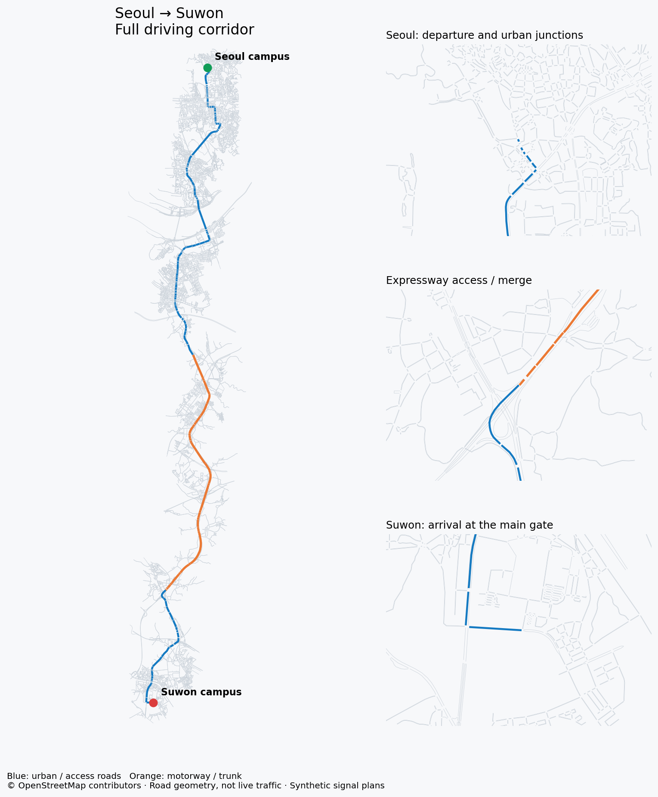
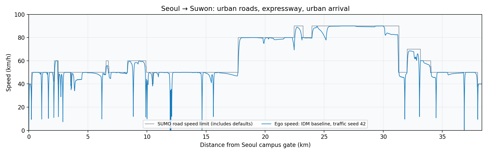

# 성균관대학교 서울 → 수원 SUMO 도로 환경

> 최신 설정과 전체 수정 내역·실행·검증 결과는 [10번 통합 문서](10_SKKU_톨게이트_차로이용_합류.md)를 참고한다.

구축·검증일: 2026-09-23. SUMO 1.27.1.

> 이 문서는 최초 도로 환경의 구축 기록이다. 아래 신호 10개·감응식 설정·완주 표는 **건물·신호 위치 보완 전** 결과이며, 당시 환경은 [road_only_snapshot](../results/skku_commute/road_only_snapshot/)에 보존했다. 현재 환경과 새 검증 결과는 [7_SKKU_건물_신호등_보완.md](./7_SKKU_건물_신호등_보완.md)를 따른다. 아래 기본 실행 명령은 보완된 최신 환경을 연다.

서울 인문사회과학캠퍼스 정문 앞 성균관로에서 수원 자연과학캠퍼스 정문 앞 일월로까지, **자동차전용도로를 포함하는 약 38.35km 주행 환경**을 구축했다. 도심 교차로, 다차로 도로, 자동차전용도로 진입·합류·진출, 수원 시내 진입을 하나의 경로에서 경험할 수 있다.

현재 완료 범위는 **실제 지도 기반 도로 생성, 배경 교통 구성, SUMO 기본 운전 모델의 완주 검증, GUI 실행 도구**이다. 이 경로에 대한 PPO 학습은 아직 수행하지 않았다.



## 1. 출발·도착과 실제 경로

학교 공식 캠퍼스 지도의 정문 위치를 확인하고, 차량이 접근하는 **정문 바깥 공공도로**에 시작점과 도착점을 연결했다. 교내 도로를 통과하거나 건물 중심에서 출발하지 않는다.

| 지점 | 경도, 위도 | OSM 도로 |
|---|---|---|
| 서울 출발 | 126.9972919, 37.5847826 | 성균관로, way `37401405` |
| 수원 도착 | 126.9738000, 37.2906472 | 일월로, way `561229641` |

주요 경유 도로는 성균관로 → 창경궁로 → 서울 도심·한강 횡단 구간 → 동작대로·과천대로 → **봉담과천로** → 경수대로·서부로 → 일월로이다. 정확한 도로 순서와 차선 수·속도는 [route.json](../env/skku_commute/route.json)의 `edges`에 기록했다. 지도상의 도로명은 OSM 명칭이며, 일부 긴 구간의 명칭이 일반적인 내비게이션 표기와 다를 수 있다.

이번에 선택한 경로는 봉담과천로를 이용한다. 경부고속도로 경유 대안도 있었지만, 선택된 경로의 자동차전용도로 본선은 OSM `trunk` 분류이다.

| 항목 | 값 |
|---|---:|
| OSRM 원본 경로 길이 | 38.5244 km |
| SUMO 실제 완주 거리 | 38.34756 km |
| SUMO 외부 도로 길이 합계 | 34.98566 km |
| 교차로 내부 연결부를 더한 경로 길이 | 약 38.34 km |
| 주행 경로의 외부 도로 수 | 226 |
| `trunk` 본선 길이, 내부 연결부 제외 | 13.37347 km |
| 경로상의 최대 설정 제한속도 | 90 km/h |
| 출발·도착 좌표의 도로 중심선 연결 오차 | 각각 약 1.61 m |

SUMO는 도로 본체와 교차로 내부 연결부를 따로 저장한다. 따라서 외부 도로만 합산한 35km를 전체 주행 거리로 해석하면 안 된다. 원본 OSRM 경로는 데이터 다운로드 범위를 결정하며, 실제 주행 경로는 SUMO가 승용차 통행 가능 연결을 따라 계산한다. 현재 교통을 반영한 내비게이션 경로나 소요시간은 아니다.

## 2. 데이터와 변환

[download_skku_corridor.py](../download_skku_corridor.py)가 OSRM 자동차 경로를 약 3km 단위로 나누고, 각 구간 주변 약 650m 여유를 둔 사각 영역에서 OSM 도로·회전 제한 관계·참조 노드를 수집한다. 교차로 연결을 유지하기 위해 도로 전체 형상을 보존하므로 실제 네트워크 범위가 여유 폭보다 넓어지는 곳도 있다.

- 계획 구간 13개, 분할 다운로드 후 사용 타일 15개.
- 중복 제거 후 원본 노드 42,192개, way 8,911개, 관계 457개.
- 최종 SUMO 외부 도로 27,802개, junction 11,006개, 신호 제어기 76개. 주행 경로상 신호 제어기는 10개.
- way 노드 참조·relation 멤버 참조 누락 0개를 확인했다. 관계의 의미 자체가 완전하다는 뜻은 아니다.
- 원본 XML, 요청 쿼리, 서버, 데이터 기준 시각, SHA-256을 모두 보존했다.
- DE 서버의 요청 제한·연결 장애로 HPI 서버를 함께 사용했다. 타일 데이터 기준 시각은 9월 22~23일이며, 중복 객체는 높은 버전을 선택했다. 정확한 시각은 타일별 기록을 따른다.
- 기본 재실행은 해시가 일치하는 캐시를 재사용한다. 검증 과정에서 외부 재요청 없이 동일한 병합 원본을 얻었다.

원본은 [source/manifest.json](../env/skku_commute/source/manifest.json), 최초 변환·시뮬레이션 가정은 [보존된 manifest.json](../results/skku_commute/road_only_snapshot/manifest.json)에 기록되어 있다. 병합 원본 SHA-256:

```text
ef7b4e3119e3e5a20bdcbc49ea895fe705420df986171675f0a4c56761da8720
```

[build_skku_commute.py](../build_skku_commute.py)는 `netconvert`로 도로 형상을 변환하고, 승용차 연결 검사·경로 생성·주변 교통·GUI 설정·전체 지도 이미지를 만든다. OSM의 일방통행·차선·속도 태그를 사용하며, 없는 값에는 다음 실험용 기본값을 적용한다.

| 도로 유형 | 누락 시 속도 | 누락 시 차선 수 |
|---|---:|---:|
| motorway / trunk 본선 | 100 / 80 km/h | 2 |
| primary / secondary | 50 km/h | 2 |
| tertiary | 40 km/h | 1 |
| residential / unclassified | 30 km/h | 1 |
| service / living_street | 20 km/h | 1 |

연결로 기본값은 [skku_commute.typ.xml](../env/skku_commute/skku_commute.typ.xml)에 별도로 기록되어 있다. 신호는 SUMO가 생성한 감응식 프로그램이며, 명목 주기는 90초이다. 진입·진출로 차선과 교차로 차선 연결에도 추정이 포함된다. 실제 현장 신호 시간표를 수집한 결과는 아니다.

## 3. 주변 교통과 표시

주변 교통은 **실험용 합성 수요**이다. 서울에서만 모든 차량을 출발시키면 초반 수원 쪽 도로가 비어 있으므로, 경로를 따라 겹치는 약 5km 구간과 유입도로에 분산 배치했다.

- 본선 구간 흐름 14개: 각 기대 100대/시간.
- 주변 도로에서 들어오는 흐름 13개: 각 기대 60대/시간.
- 전체 생성률 합계: 기대 2,180대/시간. 한 지점의 실제 관측 교통량을 뜻하지 않는다.
- 주변 차량 추종 모델: IDM 60%, Krauss 40%. 출발 시각과 운전 속도에 난수를 적용한다.
- 빨간 차량 `ego`: IDM, 고정 속도 계수 1.0, SUMO 자동 차선변경·안전 제어 사용.
- 모든 차량은 `passenger/sedan`과 상세 차량 표시 품질 2를 사용한다.
- 시뮬레이션 간격 0.5초, 최대 7,200초. 막힌 차량을 자동으로 옮기는 teleport는 비활성화한다.

## 4. 최초 도로 환경의 완주 검사 결과

건물·신호 위치 보완 전 설정으로 단독 주행 1회와 배경 교통 seed 42·43·44를 검사했다. 각 검사는 도로 연결뿐 아니라 실제 출발·도착, 충돌, teleport, 주행 거리, 대기시간을 기록한다. `tripinfo.xml`의 완주 거리와 시간을 최종값으로 사용했다.

| 조건 | 완주 시간, 시뮬레이션 기준 | 주행 거리 | 충돌 보고 / teleport | ego 차선변경 |
|---|---:|---:|---:|---:|
| 단독, seed 42 | 40분 45초 | 38.34756 km | 0 / 0 | 9 |
| 배경 교통, seed 42 | 41분 26.5초 | 38.34756 km | 0 / 0 | 33 |
| 배경 교통, seed 43 | 41분 7.5초 | 38.34756 km | 0 / 0 | 41 |
| 배경 교통, seed 44 | 41분 39.5초 | 38.34756 km | 0 / 0 | 32 |

배경 교통 검사에서는 ego 도착까지 각각 총 1,464 / 1,491 / 1,508대가 출발했다. 검사 종료 시 도로에 남은 주변 차량은 미완주 상태로 출력된다. 이는 ego의 실패나 강제 이동을 뜻하지 않는다.

이 결과는 **이 설정에서의 기본 운전 모델 완주 확인**이다. 대규모 안전성 평가나 강화학습 정책의 성능 검증은 아니다. 단독 주행과 서로 다른 교통 난수에서 도로가 끊기지 않고 목적지에 도달하는지 확인하는 목적이다.

- [단독 검사 결과](../results/skku_commute/baseline_isolated_seed42/summary.json)
- [배경 교통 seed 42](../results/skku_commute/baseline_background_seed42/summary.json)
- [배경 교통 seed 43](../results/skku_commute/baseline_background_seed43/summary.json)
- [배경 교통 seed 44](../results/skku_commute/baseline_background_seed44/summary.json)
- [GUI 완주 결과](../results/skku_commute/gui_validation_seed42/summary.json)와 [화면 캡처](../results/skku_commute/gui_validation_seed42/gui.png): seed 42 배경 교통 결과와 일치한다.
- [최초 검증 목록·입력 해시](../results/skku_commute/road_only_snapshot/experiment_index.json)
- 각 결과 폴더에 `trajectory.csv`, `tripinfo.xml`, `statistics.xml`, SUMO 로그가 있다.



## 5. 실행 방법

프로젝트 루트 `/home/mk/bmil_ws`에서 실행한다. 현재 PC는 시스템에 설치된 SUMO를 사용해 `python3`로 실행한다. 다른 환경에서 필요한 패키지와 `.venv-skku` 설정은 [README](../README.md)를 참고한다. 아래 재생성 명령은 가상환경 설정 후 사용한다.

```bash
# 주변 차량과 함께 GUI 실행: 빨간 ego를 자동 추적
python3 run_skku_commute.py --gui --background --viewport-m 800 --keep-open

# 도로 연결만 빠르게 확인: ego 한 대
python3 run_skku_commute.py

# GUI 없이 주변 교통을 넣어 완주 검사
python3 run_skku_commute.py --background --seed 43

# 저장된 원본을 재사용하여 도로 전체 재생성
.venv-skku/bin/python download_skku_corridor.py
.venv-skku/bin/python build_skku_commute.py

# 원본·네트워크 해시가 같을 때 교통량 등 파생 파일만 다시 생성
.venv-skku/bin/python build_skku_commute.py --skip-convert --segment-vph 100
```

기본 결과 폴더는 `results/skku_commute/` 아래 시각별로 생성한다. 직접 지정하려면 `--output-dir`을 사용한다. `--delay-ms`로 GUI 재생 지연을, `--viewport-m`으로 추적 화면 범위를 조절할 수 있다. `--keep-open`은 검사가 끝난 뒤 GUI를 남긴다. 처음부터 전체 지도를 보려면 SUMO의 화면 전체 맞춤 기능을 사용한다.

원본을 새로 받을 때만 `download_skku_corridor.py --refresh --overpass-url https://osm.hpi.de/overpass/api/interpreter`를 사용한다. 새 OSM이나 새 SUMO 버전에서는 도로 ID·신호·경로가 바뀔 수 있으므로, 변환 후 완주 검사를 다시 실행해야 한다.

## 6. 알려진 한계와 다음 학습 작업

현재 자료는 실제 도로 형상에서 출발한 시뮬레이션 환경이며, 현장 측량으로 보정한 정밀 지도가 아니다. 경로에 대응한 원본 way 121개 중 일반 `maxspeed` 태그는 27개, `lanes` 태그는 46개에 있다. 태그 누락 구간에는 앞서 설명한 기본값이 들어간다. 실제 교통량·신호 시간·차선별 통행 규칙의 보정이 필요하다.

변환 로그에는 일부 불완전한 회전 제한·차로 방향 태그와 감응식 신호의 검지기 경고가 남아 있다. 경로 관련 회전 제한을 별도로 점검했으며 [restriction_audit.json](../env/skku_commute/restriction_audit.json)에 결과를 기록했다. 원본 관계 `16705869`는 from 멤버만 있어 정확한 제한을 복원할 수 없다. 감응식 검지기 경고 중 경로에 걸리는 제어기는 1개이며, 위 완주 검사에서는 진행을 막지 않았다. 이는 실제 제한이나 신호 배치까지 검증했다는 의미가 아니다.

강화학습을 이어갈 때는 다음 작업이 필요하다.

1. 서울→수원 네트워크·경로를 사용하는 학습 환경을 새로 구성한다. 에피소드 길이와 관측 정규화·속도 범위를 장거리·최대 90km/h 조건에 맞춘다.
2. 짧은 도심 구간 → 진입·합류 구간 → 자동차전용도로 → 전체 구간 순서로 학습 과제를 구성한다. 처음부터 40분짜리 구간의 도착 보상에만 의존하면 학습 신호가 드물어진다.
3. 차량 밀도·속도·합류 시각을 다양하게 하고 별도 seed와 구간에서 평가한다. 안전 제어 개입률과 신호 위반을 별도로 기록하고 보상·관측을 검증해야 한다.

이 경로에서 학습한 체크포인트는 없다. 이번 기본 주행 결과를 안전 제어 없이 운전하는 RL 결과로 해석하면 안 된다.

## 출처

- [성균관대학교 공식 서울 캠퍼스 지도 데이터](https://www.skku.edu/skku/about/campusInfo/campusMap.do?mode=buildList&campusCd=1)
- [성균관대학교 공식 수원 캠퍼스 지도 데이터](https://www.skku.edu/skku/about/campusInfo/campusMap.do?mode=buildList&campusCd=2)
- [SUMO 공식 OSM 가져오기 문서](https://sumo.dlr.de/docs/Networks/Import/OpenStreetMap.html)
- 도로 데이터: © OpenStreetMap contributors, [ODbL 및 저작권 안내](https://www.openstreetmap.org/copyright)
- OSRM 요청 URL과 각 Overpass 쿼리는 원본 manifest·타일 기록에 보존했다.
