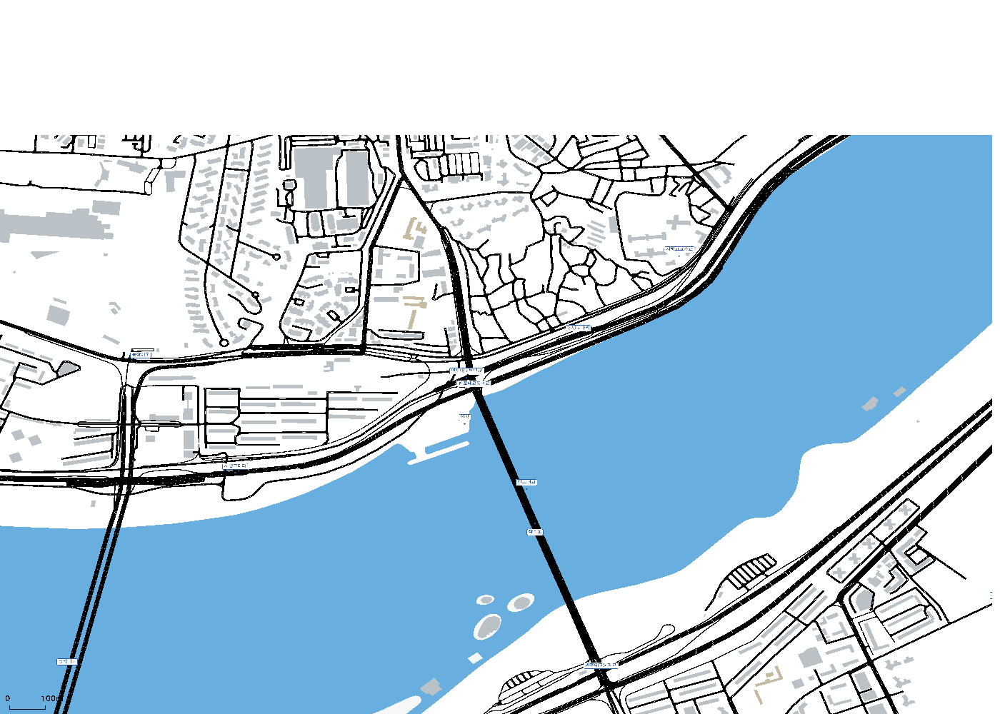
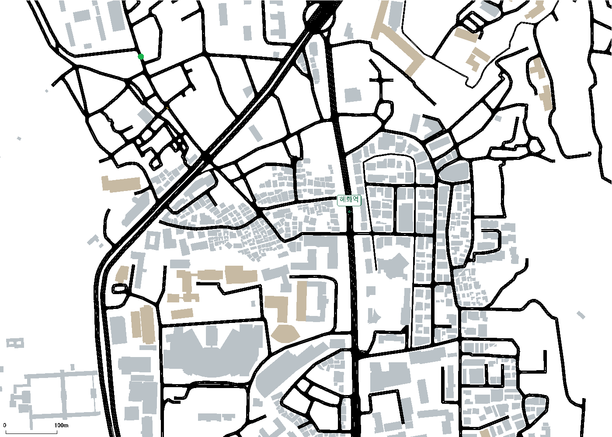
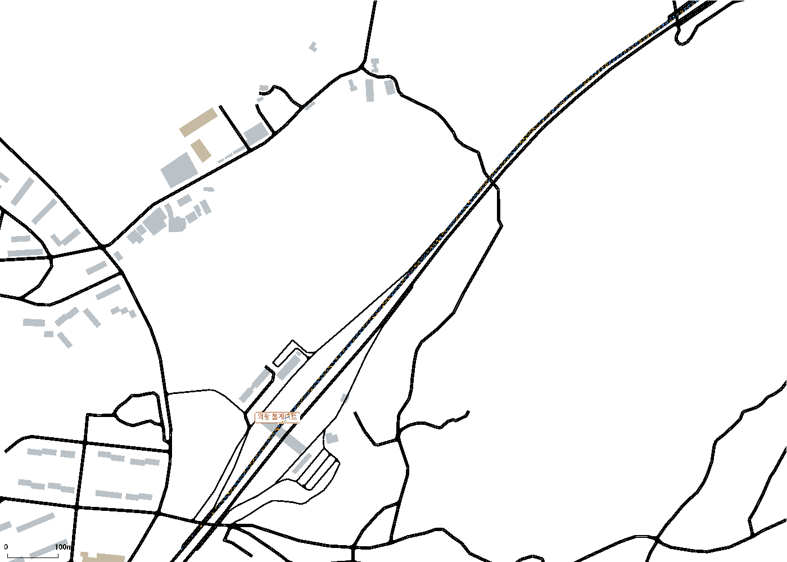

# SKKU 서울 → 수원: 한강·지명 표시와 정체

> 이후 본선 4차로·톨게이트 6차로 보정과 소교량 이름표 정리를 추가했다. [현재 차로·교량명 설정 및 검사 결과](9_SKKU_본선_차로_교량명_보완.md)를 참고한다. 아래 수치와 화면은 차로 변경 전 기록이다. 전체 수정 내역과 최신 실행·검증 결과는 [10번 통합 문서](10_SKKU_톨게이트_차로이용_합류.md)에 정리했다.

2026-09-24. [건물·신호 보완](7_SKKU_건물_신호등_보완.md) 이후의 당시 설정이다. 도로 네트워크와 주행 경로는 유지하고 배경 지도와 교통 수요를 변경했다.

## 실행

```bash
cd /home/mk/bmil_ws
python3 run_skku_commute.py --gui --background --viewport-m 800 --keep-open
```

Ubuntu의 `/usr/share/sumo/tools`를 실행기가 자동으로 찾으므로 별도 가상환경이나 `PYTHONPATH` 설정 없이 실행할 수 있다. SUMO와 Python 모듈이 설치되어 있어야 한다.

시뮬레이션 시작 후 **300초간 주변 교통을 먼저 채우고 빨간 ego 차량을 출발**시킨다. 기본 GUI 지연에서는 출발까지 약 12초가 걸릴 수 있다. `--viewport-m 800`은 가까운 지명도 보기 위한 범위이고, 차량을 크게 보려면 `180`으로 줄인다. `--delay-ms 0`은 최대 속도로 재생한다. `--background`를 빼면 주변 차량 없이 즉시 출발하지만 톨게이트 접근 구간 속도 제한은 유지된다.

## 반영한 네 가지

1. **한강 수면**: OSM 한강 multipolygon 관계 `152336`의 외곽선과 섬을 투영했다. 수면은 청색 `#68AEDE`, 레이어 `-10`으로 표시하여 도로·교량 아래에 놓는다. 표시 영역으로 자른 수면·섬 폴리곤은 7개다.
2. **서울 시내 교통**: 기존 100대/시간의 겹치는 구간별 수요를 서울 북쪽 200대/시간, 남쪽 130대/시간으로 늘렸다. 서울 합류 수요는 60대/시간에서 100대/시간으로 늘렸다. 구간 시작점 위도 37.54/37.46으로 나눈 실험 구역이며 행정경계 구분은 아니다.
3. **의왕 톨게이트 직전 정체**: OSM 남행 톨게이트 노드 `1142439460`에 대응하는 접근 도로 `507449308`의 승용차 차로에 2m/s(7.2km/h) 제한을 적용했다. 이 도로는 약 595m이고, 톨게이트보다 앞에서 감속한 차량 때문에 상류에 서행 행렬이 생긴다. 별도의 약 4.4km 교통 경로에서 1,200대/시간을 유입한다. 실제 요금소 처리시간이나 운영 차로를 복원한 것은 아니며, 기존 도로 전체 구간에 적용하는 합성 병목이다.
4. **주요 지점 이름**: 주행 경로 1.2km 이내 OSM 자료에서 역 37곳, 톨게이트 4곳, 교량·고가 16곳과 한강까지 **58개 이름표**를 표시한다. 역은 초록, 톨게이트는 갈색, 교량·한강은 파란 테두리다. 위치의 점과 이름표를 함께 표시한다. 반포대교와 잠수교는 별도 이름표로 표시한다. OSM에 없는 지명이나 범위 밖의 모든 시설까지 포함한다는 뜻은 아니다.

SUMO 기본 글꼴의 한글 표시 문제를 피하기 위해 이름표는 Noto Sans CJK로 만든 PNG 텍스처다. 생성 후 실행할 때는 이미지 파일을 사용한다. 이름표는 실제 위치 주변에 있으므로 좁은 차량 추적 화면에서는 가까운 시설도 화면 밖일 수 있다.

교통량과 병목은 관측 자료로 보정하지 않은 실험 설정이다. 정체가 강한 시나리오이며 실제 출퇴근 시간 예측값으로 사용하지 않는다. 의왕 대기열은 완전 정지보다 저속으로 계속 움직이는 형태다. 병목 구현은 SUMO의 [Variable Speed Signs](https://sumo.dlr.de/docs/Simulation/Variable_Speed_Signs.html)를 사용한다.

## 검사 결과

| 검사 | 결과 |
|---|---|
| 일반 실행, seed 42 | 38.347km 완주, 출발 후 104분 23초 |
| GUI 실행, seed 43 | 시뮬레이션 시각 6,840.5초에 도착, 300초 출발 기준 약 109분 |
| 두 실행의 충돌 / 강제 이동(teleport) | 모두 0 / 0 |
| GUI 검사 중 서울 경로의 동시 정지 차량 | 최대 255대 |
| 톨게이트 상류 저속 도로의 차량 | 최대 558대 |
| ego의 톨게이트 접근 구간 속도 | 10초 간격 204회 표본 중 201회에서 3m/s 미만 |
| 기존 건물 기하 검사 | 3개 통과 |

상류 저속 차량 수는 톨게이트 앞 약 2km 이상을 포함하도록 도로 단위로 선택한 구간에서 **평균 속도 5m/s 미만인 도로에 있는 차량 수**를 합산한 값이다. 개별 차량 속도 또는 정확한 정체 길이를 측정한 값은 아니다. 서울 정차 표본에는 신호 대기도 포함된다. 배경 차량 급제동 경고는 남아 있다.

근거: [seed 42 주행 요약](../results/skku_commute/landmarks_final_seed42/summary.json), [GUI·정체 검사](../results/skku_commute/landmarks_final_gui_seed43/audit.json). 이전 문서의 약 58분 완주 기록은 이번 교통량 설정과 다르다.





## 재생성과 자료

```bash
# 보관된 지도 자료 사용. 새로 수집하려면 --refresh 추가.
python3 download_skku_landmarks.py
# 기존 도로를 유지하고 교통·한강·지명·설정을 재생성.
python3 build_skku_commute.py --skip-convert
# GUI 표시, 상류 서행과 완주를 함께 검사.
python3 validate_skku_landmarks.py --gui --seed 43 --output-dir results/skku_commute/my_visual_check
```

이름표 재생성에는 Pillow, fontconfig와 한국어 글꼴이 필요하다. 기본 수요는 `build_skku_commute.py --skip-convert --segment-vph 100`이며 이 값에 지역별 배율을 적용한다. 수요를 바꾸면 완주와 정체를 다시 검사해야 한다.

[지도 생성기](../build_skku_landmarks.py), [지도 원본·쿼리·수집 시각](../env/skku_commute/landmarks_source/), [지명·이미지 해시 기록](../env/skku_commute/landmarks.manifest.json), [정체 설정](../env/skku_commute/congestion.manifest.json), [통합 검사기](../validate_skku_landmarks.py).

지도 출처: © OpenStreetMap contributors, [ODbL 1.0](https://www.openstreetmap.org/copyright). 실행 결과의 입력 해시로 사용한 도로·교통·추가 표시 파일을 확인할 수 있다.
