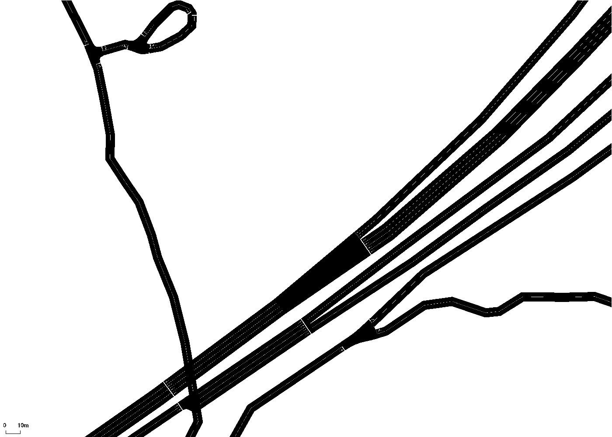
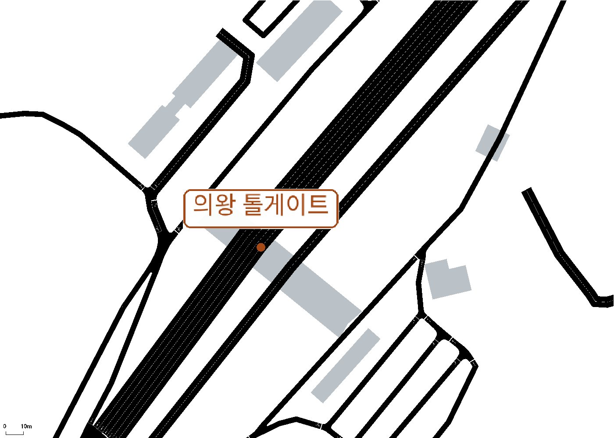
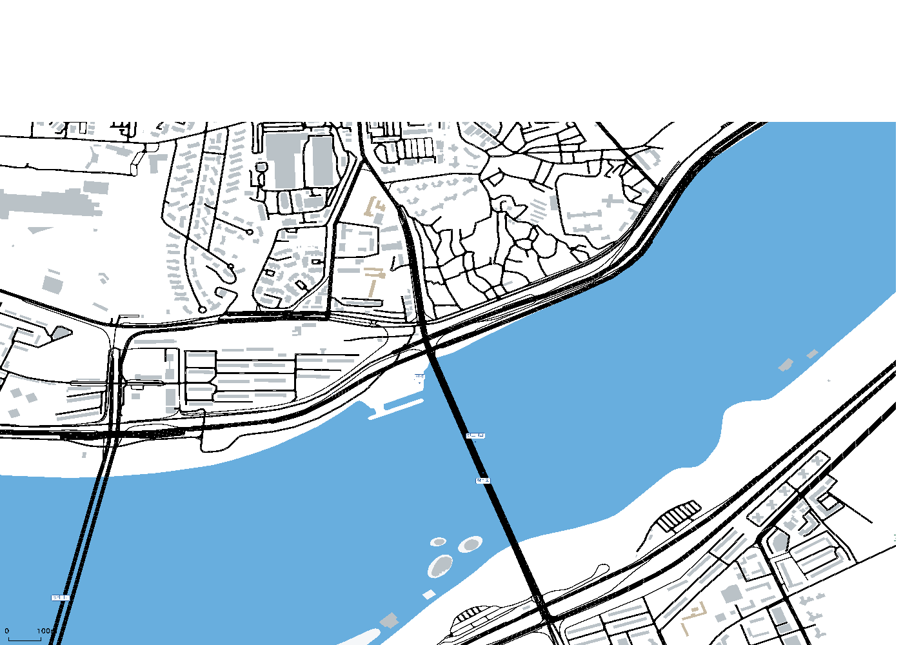

# SKKU 서울 → 수원: 본선 차로와 교량 이름표 보완

> 이후 추가 차로의 실제 이용과 합류 동작을 보완했다. [전체 수정 내역·현재 설정·시뮬레이션 검증 결과](10_SKKU_톨게이트_차로이용_합류.md)를 참고한다. 아래는 연결 검사 단계의 기록이다.

2026-09-24. [한강·지명·정체 설정](8_SKKU_한강_지명_정체.md)에 이어, 사용자 요청을 기준으로 봉담과천로 **수원 방향 주행 본선을 4차로, 의왕 톨게이트 접근 구간을 6차로**로 보정했다. 현장 측량을 새로 수행한 결과가 아니라 요청한 차로 구성을 반영한 시나리오다.

## 반영 범위

- 현재 주행 경로의 `봉담과천로` 본선 25개 도로 구간은 4차로를 유지한다. 중간에 2차로로 줄어드는 설정을 제거했다.
- 의왕 톨게이트를 포함한 `507449308` 구간(약 595m)은 6차로다. 전후 연결은 **4 → 6 → 4차로**이며, 6개 차로 모두 진입과 출구 연결이 있다. 출구의 3개 바깥 차로는 본선 바깥쪽 차로로 합류한다.
- 기존 중앙분리대 쪽 경계를 유지하면서 바깥쪽으로 확장했다. SUMO `netconvert`로 차로 형상과 합류·분기 연결을 함께 생성했다. 원본 OSM, 반대 방향 차로 수와 지선 차로 수는 변경하지 않았다.
- 교량 이름은 경로 주변의 **반포대교·잠수교·동작대교**만 남겼다. 진입·진출부 소교량, 고가교 이름과 중복된 동작대교 표시는 제외했다. 지하철역과 톨게이트 이름표는 유지하여 전체 표시 지점은 45곳이다.
- 서울 교통량, 의왕 접근 구간의 실험용 저속 제한과 차량 유입은 유지했다. 차로 확장 후 정체는 이전보다 완화되었지만 톨게이트 상류 서행 행렬은 확인했다.

현재 통행을 제어하는 신호 프로그램은 바뀌지 않았다. 재변환 과정에서 차량 연결에 사용되지 않던 신호 프로그램 1개만 제거되었다. 기존 신호 자료의 위치 근거는 그대로 두고, 새 네트워크 해시는 [차로 보정 기록](../env/skku_commute/lanes.manifest.json)에 따로 기록했다.

## 실행

기존 SUMO 창에는 로딩 당시 지도가 남아 있으므로 창을 닫고 다시 실행한다.

```bash
cd /home/mk/bmil_ws
python3 run_skku_commute.py --gui --background --viewport-m 800 --keep-open
```

차량은 시뮬레이션 300초에 출발한다. 차로를 가까이 보려면 `--viewport-m 250`을 사용한다.

## 확인 결과

| 검사 | 결과 |
|---|---|
| 본선 차로 수 | 25개 구간 모두 4차로 |
| 톨게이트 구간 | 6차로, 모든 차로 진입·출구 연결 통과 |
| 일반 주행 seed 42 | 약 38.34km 완주, 주행 83분 38.5초 |
| GUI 주행 seed 43 | 완주, 출발 후 약 86분 18초 |
| 두 주행의 충돌 / 강제 이동 | 모두 0 / 0 |
| GUI 검사: 톨게이트 상류 저속 도로 차량 | 최대 61대 |
| GUI 검사: 톨게이트 상류 정지 차량 | 최대 13대 |

저속 도로 차량 수는 평균 속도 5m/s 미만인 접근 도로에 있는 차량 수의 합계다. 정확한 대기열 길이나 개별 차량 속도별 집계가 아니다. 10초 간격으로 수집한 ego의 톨게이트 접근 표본 65회 중 55회는 3m/s 미만이었다. 급제동 경고는 남아 있다.

[일반 주행 요약](../results/skku_commute/lanes_final_seed42/summary.json), [GUI·차로 연결·정체 검사](../results/skku_commute/lanes_gui_seed43/audit.json).





## 재생성

```bash
python3 build_skku_commute.py --skip-convert
python3 validate_skku_landmarks.py --gui --seed 43 --output-dir results/skku_commute/my_lane_check
```

[차로 보정기](../build_skku_lanes.py)는 일반 전체 빌드에도 포함되어 있다. 이미 적용된 네트워크의 재빌드에서는 차로를 다시 늘리거나 도로 형상을 추가로 이동시키지 않는다. 변경 전 네트워크는 `env/skku_commute/lanes_source/`에 해시별 압축 파일로 보관했다. [실험 목록](../results/skku_commute/experiment_index.json)의 `previous_revision`에는 이전 설정의 결과를 보존했다.

구현 참고: SUMO [PlainXML의 차로 및 연결 수정](https://sumo.dlr.de/docs/Networks/PlainXML.html#patching-connections-and-guessing-again). 교량 이름과 위치의 원본은 이전 문서에 기록한 OSM 자료다.
